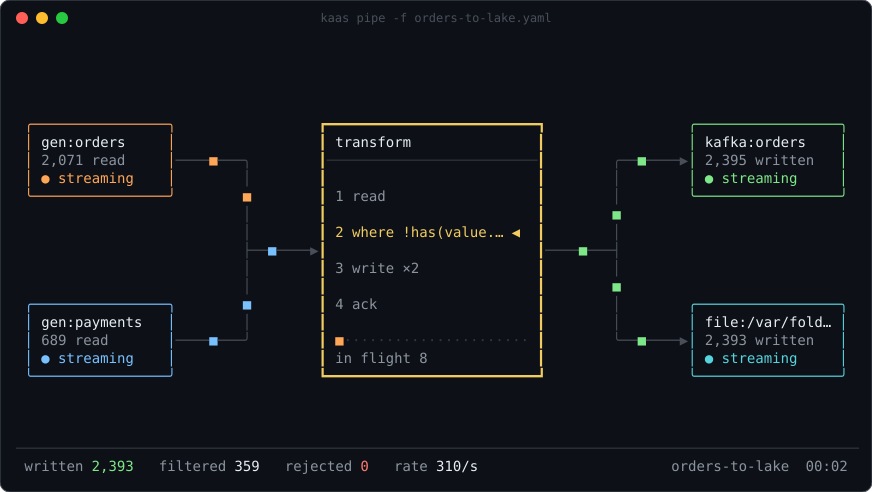
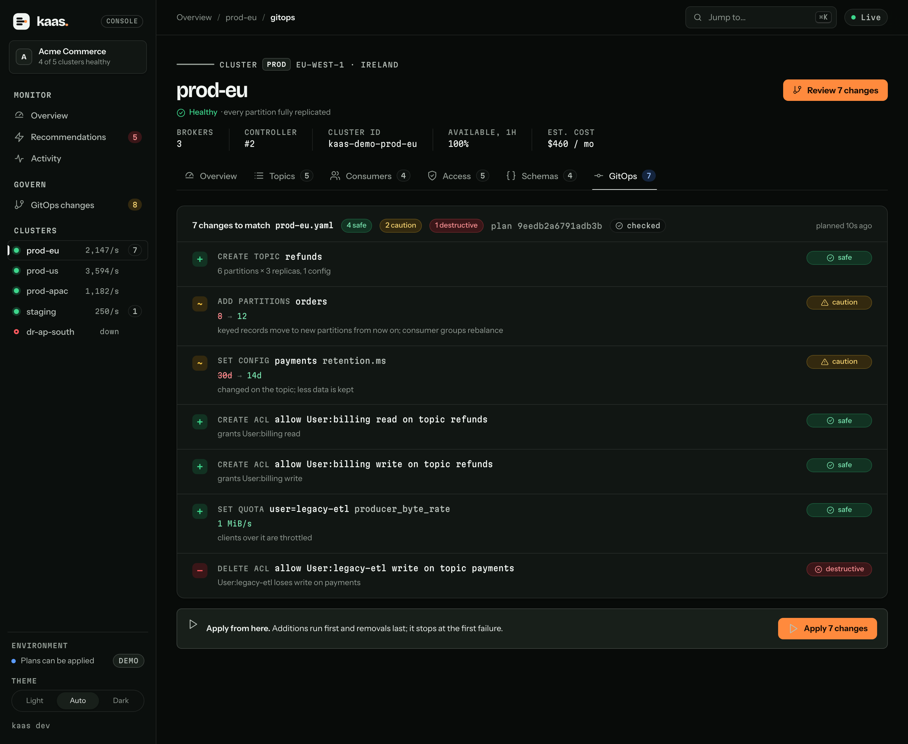

# KaaS: Kafka As A Service

**Know what your Kafka cluster is doing, change it safely, and move data through it, from one fast binary.**


`kaas` is a CLI and terminal UI for any Apache Kafka cluster. On a terminal, every command draws a screen built for its job. On a pipe it prints stable text, and with `-o json` it prints JSON. It is the first of three products built on one shared cluster-state engine:

1. **`kaas`**, the CLI and TUI. *Available now.*
2. **A management plane** for many clusters: GitOps plans, schemas, ACLs and quotas, in a web console. *Available now.*
3. **Managed Kafka on Kubernetes**: create, roll and autoscale clusters. *Phase 3.*

## Documentation

| Guide | For |
|---|---|
| **[Usage guide](docs/USAGE.md)** | Every command, its flags, screens and script output, including pipes and plugins |
| **[Feature guide](docs/FEATURES.md)** | What kaas can do, grouped by the job you're doing |
| **[Use cases](docs/USE-CASES.md)** | How kaas helps a company: on-call, replays, data movement, testing, capacity, safety |
| **[Testing guide](docs/TESTING.md)** | The test tiers that prove it, from fuzzing to chaos on real brokers, and the bugs they caught |
| [Design docs](docs/design/) and [ADRs](docs/adr/) | Why it's built the way it is |

## Install

```bash
go install github.com/IshaanNene/Kafka-as-a-Service/cmd/kaas@latest
export KAAS_BROKERS=localhost:9092      # or -b on each command
```

## Quick start

```bash
kaas                                     # the terminal UI (: command · / filter · ? help)
kaas snapshot                            # one look at the cluster, problems first
kaas watch -t orders                     # leader moves, ISR changes and record growth, live
kaas lag                                 # consumer groups ranked by how far behind they are
kaas consume orders --from -20           # the last 20 records of each partition, then follow
kaas offsets reset billing -t orders --to 2h   # replay two hours, as a reviewed plan
kaas config edit orders                  # configs in a vi-style buffer, diffed before applying
kaas bench produce -t orders --size 100,1024 --compression none,lz4   # throughput and latency
kaas help <command>                      # usage and worked examples
```

### Move data with pipes

```bash
kaas pipe --from 'kafka:orders?stop=end' --to file:orders.jsonl            # export a topic
kaas pipe --from listen://:8080/ingest --to kafka:events                  # HTTP into Kafka
kaas pipe --from 'kafka:orders?group=fraud' --where 'value.amount > 1000' \
  --to https://fraud.example.com/hook --to kafka:audit                    # filter and fan out
kaas pipe --from 'gen:orders?rate=5000' --to kafka:load-test --for 10m    # load generation
```



Pipes deliver at least once: a source is acknowledged only after every sink wrote its records. Built-in endpoints:
- Kafka, as a consumer group;
- files in JSON lines, CSV or text;
- stdin and stdout;
- HTTP webhooks, and an HTTP listener;
- a data generator.

Any executable named `kaas-source-<name>` or `kaas-sink-<name>` that speaks JSON lines becomes an endpoint too. [Plugins →](docs/USAGE.md#plugins)

## The console: every cluster, one page

```bash
kaas console --demo                       # five made-up clusters with live traffic, at http://127.0.0.1:7070
kaas console --fleet fleet.yaml           # your clusters
```


`kaas console` serves a web console from the same binary. Its overview answers what a business asks of Kafka: is it up, is data flowing, how fresh is it, what does it cost, and what needs doing. It shows every cluster in a fleet, each with:
- availability over the last hour, minute by minute;
- records produced and consumed, and how far behind each consumer is in time;
- recommendations worst first, each with its impact and the command that fixes it;
- an estimated monthly cost;
- topics, with a partition map;
- consumer lag, with time to catch up;
- ACLs, quotas and Schema Registry subjects;
- drift from git;
- a live feed of what changes.

It is read-only by default and listens on localhost.

### GitOps: the cluster as a reviewed file

```bash
kaas plan  -f gitops/prod-eu.yaml --exit-code      # in the PR: what merging would change (exit 5 = changes)
kaas apply -f gitops/prod-eu.yaml --plan 3f9c2a1b7d04e6aa --yes   # after merge, only the reviewed plan
```



A desired-state file declares topics, configs, ACLs, quotas and CEL policies. A plan is checked by the controller before anything changes, rated safe, caution or destructive, and identified by a hash. An apply runs only the plan that was reviewed. [GitOps →](docs/USAGE.md#gitops-kaas-plan-and-kaas-apply)

## Why kaas

| Kafka teams deal with | kaas does instead |
|---|---|
| JVM shell scripts that take seconds to start and print walls of text | A single static binary that starts instantly, with a screen for each job |
| "Connection to node -1 could not be established" | A probe that says which layer broke (DNS, TCP, the Kafka protocol or metadata) and what to try |
| Deletes and config changes with no preview and no undo | Plans validated by the controller, typed confirmation, a 5-second undo, diffs before applying |
| A small service written for every data integration | `kaas pipe` with filters, YAML pipelines and plugins |
| Tools that load the controller when 20 people run them | One request budget per cluster: refreshes are skipped, never queued |
| Pretty output that breaks scripts | Screens on a terminal, plain text on pipes, JSON with `-o json`, fixed exit codes |

## Built to be trusted

- **Tested against real Kafka.**
  - Unit tests run on an in-memory cluster.
  - Integration tests run on Apache Kafka 3.9, 4.2 and 4.4 in containers.
  - Chaos tests freeze the broker mid-send, add latency and force rebalances.
  - Every parser is fuzzed, and a weekly soak checks lag and memory over hours.

  [The testing guide](docs/TESTING.md) has what each tier proves.
- **Light on the cluster.** One loop owns every request behind a token bucket. The engine diffs a 100,000-partition snapshot in about a millisecond ([design 0001](docs/design/0001-cluster-state-engine.md)).
- **Supply chain.** Releases are signed with cosign and ship an SBOM and SLSA provenance.
- **Accessible.** `NO_COLOR` keeps every layout without colour, `KAAS_REDUCED_MOTION=1` stops animation, and `--theme magic|amber|ice` switches palettes.

## Develop

Requires Go 1.26, [Task](https://taskfile.dev), golangci-lint v2, and Docker for the integration, chaos and soak tiers.

```bash
task test               # unit, kfake, contract and screen tests, race detector on
task test:integration   # real brokers in containers; KAAS_KAFKA_IMAGE=apache/kafka:4.4.0 picks one
task test:chaos         # broker paused mid-send, latency, rebalances
task test:fuzz          # every parser, FUZZTIME=30s each
task test:soak          # KAAS_SOAK_DURATION=30m, writes soak.md
task bench              # pipe and engine benchmarks
task lint               # includes the core/ import boundary (ADR-0003)
task screenshots        # regenerate docs/img from real runs against kfake
task console            # the web console on a demo fleet, served from disk for editing
task test:web           # the console's JavaScript tests (Node 20+)
task dev                # kind + Strimzi + a 3-broker KRaft cluster
```

## Layout

```
cmd/kaas/       the CLI: one file per command
core/           cluster-state engine and Kafka logic; no UI or transport imports
  pipe/         sources, sinks, the CEL filter and the plugin protocol
  plan/         desired state, plans, policies and apply (GitOps)
  acls/ quotas/ exact ACL and quota reads and writes
connectors/     pipe endpoints that need a transport, such as HTTP
ui/             TUI, command screens, the grid kit and themes
test/           kfake and Testcontainers harness, soak test
controlplane/   the management plane (Phase 2)
  console/      the web console: fleet runtime, JSON and SSE API, and the web app in web/
  schemas/      Schema Registry client
dataplane/      agent and gateway
operator/       Kubernetes operator over Strimzi (Phase 3)
deploy/         kind configs, Helm charts
docs/           guides, design docs, ADRs
```

The console's fonts (Bricolage Grotesque, Instrument Sans, Martian Mono) are under the SIL Open Font Licence, in `controlplane/console/web/fonts/`. Why the console is a web app and how it's built: [ADR-0008](docs/adr/0008-web-console.md) and [design 0002](docs/design/0002-gitops-plans-and-console.md).

Screen layouts are Go ports of [ascii-magic](https://www.ascii-magic.com/ascii) UI pieces (MIT), drawn from live data (ADR-0007). A few decorative pieces are baked into frame packs by `task asciipack` (ADR-0006); their licence and notice ship in `ui/asciipack/packs/`.

Apache Kafka is a trademark of the Apache Software Foundation. KaaS is not affiliated with or endorsed by the ASF.
