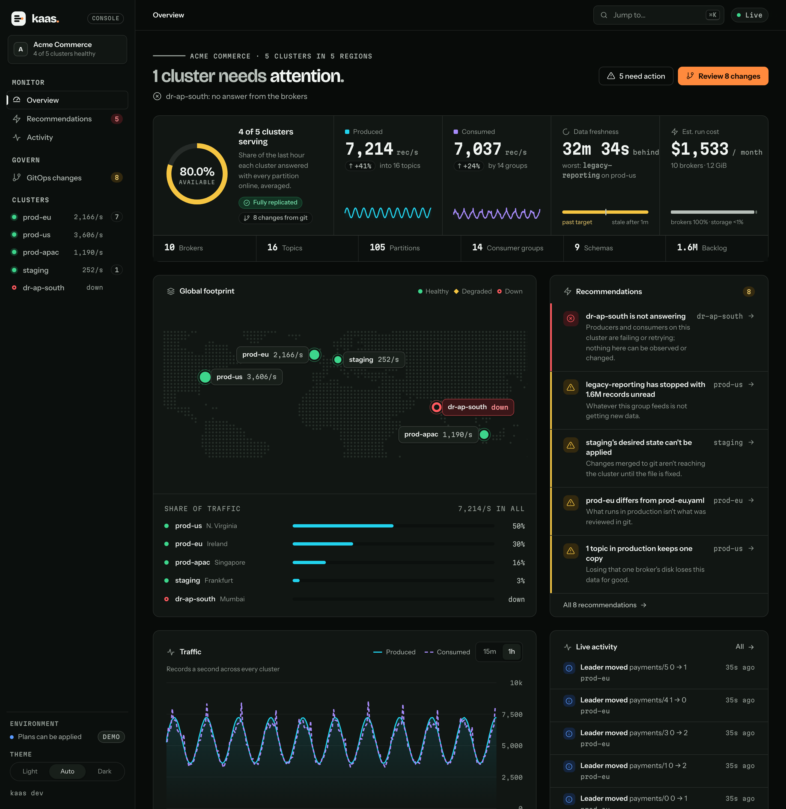

# Feature guide

What `kaas` can do, grouped by the job you're doing. Each feature links to its section of the [usage guide](USAGE.md), which has the flags and examples.

## One binary, three kinds of output

Every command works three ways, so the same tool serves an engineer at a terminal, a shell pipeline and a CI job:

| Output goes to | You get |
|---|---|
| A terminal | A screen built for the job: live tables, charts, dialogs and editors, ported from the [ascii-magic](https://www.ascii-magic.com/ascii) UI pieces in their original colours |
| A pipe or a file | Stable plain text that `grep`, `awk` and `sort -n` can rely on, often in the layout of the Kafka tool it replaces |
| `-o json` | JSON results, and errors as `{"error":{"code","exit","message","hints"}}` |

Exit codes are fixed (0 ok, 1 failure, 2 usage, 3 not found, 4 unavailable), so scripts can branch on what went wrong. `kaas` is a single static Go binary: no JVM, no scripts directory, and it starts instantly.

## See the cluster

| Feature | What it gives you | Command |
|---|---|---|
| **Terminal UI** | Topics, partitions, brokers and a live event feed, navigated with vim keys and a `:` palette | [`kaas`](USAGE.md#kaas-the-terminal-ui) |
| **Live change feed** | Leader moves, ISR shrink and expand, topics and partitions created or deleted, brokers joining or leaving, as typed events | [`kaas watch`](USAGE.md#kaas-watch-what-changed-as-it-happens) |
| **Cluster snapshot** | Every topic, problems first, with offline and under-replicated partitions and leaders per broker | [`kaas snapshot`](USAGE.md#kaas-snapshot-one-look-for-scripts-too) |
| **Retention and cost per topic** | Records retained, disk across replicas, retention and cleanup, with topic-level overrides highlighted | [`kaas topics`](USAGE.md#kaas-topics-what-each-topic-keeps-and-what-it-costs) |
| **Partition layout** | Each partition's replicas drawn per broker and sized by bytes, so skew and lagging replicas show at a glance | [`kaas topics describe`](USAGE.md#kaas-topics-describe-one-topic-partition-by-partition) |
| **Broker load** | Leaders, replicas and disk per broker, and a skew figure for the busiest broker | [`kaas brokers`](USAGE.md#kaas-brokers-who-does-the-work) |
| **Hot partitions** | Records in, records read and bytes per second for every partition, like htop | [`kaas top`](USAGE.md#kaas-top-which-partitions-are-working) |
| **Who's connected** | Consumer group members and idempotent or transactional producers, with their rates | [`kaas clients`](USAGE.md#kaas-clients-who-is-reading-and-writing) |
| **What a log holds** | A partition's log mapped by offset: compaction density, holes, committed and aborted transactions | [`kaas segments`](USAGE.md#kaas-segments-what-a-partitions-log-holds) |
| **Effective configs** | Every config of a topic or broker, with where each value comes from and the broker's docs for it | [`kaas config`](USAGE.md#kaas-config-what-a-topic-or-broker-is-set-to) |

## Find and fix consumer lag

| Feature | What it gives you | Command |
|---|---|---|
| **Lag by group** | Every group's lag, consume rate and time to catch up, refreshing in place | [`kaas groups`](USAGE.md#kaas-groups-who-is-behind-and-for-how-long) |
| **Lag leaderboard** | Group·topic pairs ranked by lag with trends, and a one-line deploy gate in JSON | [`kaas lag`](USAGE.md#kaas-lag-the-backlog-ranked) |
| **Find a moment or a bad record** | A bisect over each partition for the first record at a time, or matching a regex, in about log₂(n) reads | [`kaas offsets find`](USAGE.md#kaas-offsets-find-where-a-moment-or-a-problem-starts) |
| **Rewind or skip** | Move a group's offsets to a time, an offset or a shift, as a reviewed plan before anything is committed | [`kaas offsets reset`](USAGE.md#kaas-offsets-reset-read-again-or-skip-ahead) |

## Change the cluster safely

Every change is shown as a plan and checked by the controller before it's applied. Without a terminal, `--yes` is required, so a piped `yes` can't confirm by accident.

| Feature | Safety built in | Command |
|---|---|---|
| **Create topics** | Name checked against Kafka's rules and metric collisions; defaults read from the cluster; RF 1 warned about; the controller validates before creating | [`kaas topics create`](USAGE.md#kaas-topics-create-make-a-topic) |
| **Add partitions** | The plan says what changes for keyed records and which groups rebalance | [`kaas topics alter`](USAGE.md#kaas-topics-alter-add-partitions) |
| **Delete topics** | Type the name to arm; a 5-second undo window before anything is sent; groups still reading are named | [`kaas topics delete`](USAGE.md#kaas-topics-delete-remove-topics-with-a-moment-to-undo) |
| **Edit configs** | A vi-style editor; `:w` validates every change with the cluster and shows a diff before `y` applies it; unknown and read-only keys refused with the nearest real one | [`kaas config edit`](USAGE.md#changing-configs-kaas-config-edit) |

## Move data

| Feature | What it gives you | Command |
|---|---|---|
| **Read like a channel** | Records with key, headers and partition colour; time windows from a calendar; never joins a group or commits | [`kaas consume`](USAGE.md#kaas-consume-read-a-topic-like-a-channel) |
| **Write records** | A JSON editor that checks as you type, or one record per piped line, or many files at once with progress | [`kaas produce`](USAGE.md#kaas-produce-write-records) |
| **Pipes** | Sources to sinks with at-least-once delivery: Kafka (as a consumer group), files (JSONL, CSV, text), stdin/stdout, HTTP webhooks, an HTTP listener and a data generator | [`kaas pipe`](USAGE.md#kaas-pipe-move-records-between-kafka-files-http-and-plugins) |
| **Plugins** | Any executable named `kaas-source-*` or `kaas-sink-*` that speaks JSON lines becomes an endpoint | [Plugins](USAGE.md#plugins) |
| **Filters** | CEL expressions over key, parsed JSON value, headers and position, with filtered and rejected counted apart | [`--where`](USAGE.md#--where-filter-with-cel) |
| **Pipelines as code** | A YAML file per pipeline, reviewable in a pull request | [Pipeline files](USAGE.md#pipeline-files) |

## Measure and debug

| Feature | What it gives you | Command |
|---|---|---|
| **Producer benchmarks** | A matrix of sizes × acks × compression, with latency histograms and throughput charts | [`kaas bench produce`](USAGE.md#kaas-bench-produce-measure-dont-guess) |
| **Consumer benchmarks** | Fetch sizes and waits compared case by case | [`kaas bench consume`](USAGE.md#kaas-bench-consume-the-read-side) |
| **Load generation** | Steady made-up traffic at a set rate, for capacity tests | [`kaas pipe --from gen:…`](USAGE.md#endpoints) |
| **Request inspector** | A proxy that decodes every request a client sends: API, topics, partitions, sizes, timings | [`kaas sniff`](USAGE.md#kaas-sniff-watch-the-requests-clients-send) |
| **Startup waterfall** | Where a client's first seconds go: connect, send, queue, broker wait, ack | [`kaas sniff --trace`](USAGE.md#where-a-clients-time-goes---trace) |
| **Flame graph** | Request time by API, broker, topic and stage, with idle polls told apart from serving | [`kaas sniff --profile`](USAGE.md#where-the-time-goes---profile) |

## Run a fleet from git (Phase 2)

The management plane is a web console in the same binary, plus two commands for CI.

| Feature | What it gives you | Command |
|---|---|---|
| **Fleet console** | Every cluster on one page: availability over the last hour, produced and consumed, data freshness, estimated cost, a world map, drift, and a live event feed across the fleet | [`kaas console`](USAGE.md#kaas-console-the-fleet-in-a-browser) |
| **Recommendations** | Offline and under-replicated partitions, stopped consumers, stale data, single-copy topics, unread topics, leader skew and drift, each with its impact and a command | [Recommendations](USAGE.md#recommendations) |
| **Cluster pages** | Brokers, topics with a partition map, consumer lag with time to catch up, the request budget and the cluster's events | [Pages](USAGE.md#kaas-console-the-fleet-in-a-browser) |
| **ACLs as sentences** | "allow User:billing read on topic orders", grouped by principal, with quotas by user and client | [Access](USAGE.md#kaas-console-the-fleet-in-a-browser) |
| **Schema Registry** | Subjects, types, versions and compatibility per cluster, with the latest schema highlighted | [Fleet file](USAGE.md#the-fleet-file) |
| **Desired state in git** | Topics, configs, ACLs and quotas in one reviewed YAML file per cluster, pruning only what you allow | [Desired-state file](USAGE.md#the-desired-state-file) |
| **Plans** | Every change with its risk (safe, caution, destructive), validated by the controller first; exit 5 on drift for CI | [`kaas plan`](USAGE.md#gitops-kaas-plan-and-kaas-apply) |
| **Policies** | CEL rules such as `topic.replication >= 3` that block a plan that breaks them | [Policies](USAGE.md#the-desired-state-file) |
| **Apply exactly what was reviewed** | A plan ID ties an apply to the reviewed plan; grants before revokes; typed confirmation | [`kaas apply`](USAGE.md#gitops-kaas-plan-and-kaas-apply) |
| **Drift across the fleet** | The Changes page lists every cluster that differs from git, and the feed says when one starts to | [Changes](USAGE.md#kaas-console-the-fleet-in-a-browser) |

The console is read-only and on localhost unless you choose otherwise. Try it with no cluster at all: `kaas console --demo`.

## Errors that tell you what to do

- **Unreachable clusters** show each seed broker probed layer by layer (DNS, TCP, Kafka protocol, metadata) and which layer broke. [Troubleshooting](USAGE.md#troubleshooting)
- **Typos** get the nearest real topic, group or command names, from the live cluster.
- **Bad flags** show the flags you set with the bad one highlighted, and why it's wrong.

## Light on the cluster

`kaas` is built not to become the incident it's watching:
- **One owner per cluster.** One loop makes every request, behind a token bucket; a refresh that would exceed the budget is skipped, never queued.
- **Focused polling.** The partition on screen refreshes every second, and everything else on a slower interval.
- **Read-only reads.** `consume`, `segments`, `offsets find` and `bench consume` never join a group or commit.

The engine diffs a 100,000-partition snapshot in about a millisecond ([design 0001](design/0001-cluster-state-engine.md)).

## Accessible and themeable

- `--theme magic` (the original piece colours), `amber` or `ice`.
- `NO_COLOR` keeps every layout and drops the colour; status is carried by shape as well as colour.
- `KAAS_REDUCED_MOTION=1` stops animation.
- Screens fit from 40 to 200 columns, and CI fails a live screen that truncates.

## Proven by its tests

Unit tests run on an in-memory Kafka. Integration tests run on Apache Kafka 3.9, 4.2 and 4.4 in containers. Chaos tests freeze the broker mid-send, add latency and force rebalances. Fuzz tests run against every parser, and a soak test checks memory and lag over hours. [The testing guide](TESTING.md) explains what each tier proves.
