# KaaS — Kafka As A Service

**Know what your Kafka cluster is doing, and why it broke, without leaving the terminal.**

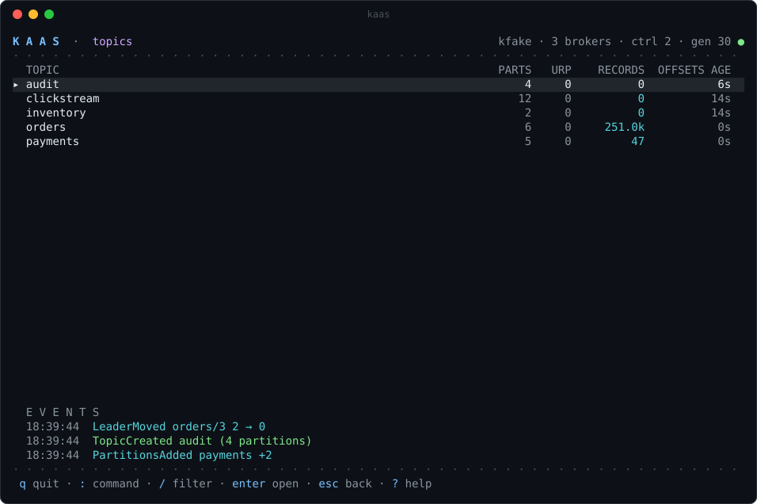

KaaS is one Go codebase that grows into three products:

1. **`kaas`**: a fast, single-binary CLI and terminal UI for any Apache Kafka cluster. *Available now.*
2. **A management plane**: one place to run many clusters, with GitOps plans, schemas, ACLs and quotas. *Phase 2.*
3. **Managed Kafka on Kubernetes**: create, roll and autoscale clusters as a service. *Phase 3.*

All three sit on the same cluster-state engine. That means the screens you learn today become the ones you use to operate a fleet later.

> Every image on this page is a real screen. `task screenshots` drives the actual commands against an in-memory Kafka cluster and saves what they draw. Nothing here is a mock-up.

---

## Why KaaS

| What Kafka teams deal with today | What `kaas` does instead |
|---|---|
| JVM shell scripts that take seconds to start and print walls of text | One static Go binary that starts instantly, with a screen built for each job |
| "Connection to node -1 could not be established" | A layer-by-layer probe that says *which* layer broke (DNS, TCP, protocol or metadata) and what to try |
| Polling `kafka-topics --describe` in a loop to catch a leader move | A live event stream: leader moves, ISR shrinks, topics created and deleted, as typed events |
| `kafka-producer-perf-test`, one setting at a time | A benchmark matrix (sizes × acks × compression) with live latency histograms |
| Tools that hammer the controller when 20 people run them | A per-cluster request budget: refreshes are skipped, never queued, so `kaas` can't become the incident |
| Pretty output that breaks your scripts | Screens on a terminal; stable text on pipes; JSON with `-o json`; fixed exit codes |

### Built to production standards

- **Bounded load.** One loop owns every request to a cluster, behind a token bucket. The engine diffs a 100,000-partition snapshot in about 1 ms ([design 0001](design/0001-cluster-state-engine.md)).
- **Tested against real Kafka.** Unit and property tests run on an in-memory cluster. Integration tests run against Apache Kafka 3.9, 4.2 and 4.4 in containers. Every screen has golden tests and is fit-tested from 40 to 200 columns. Live screens fail CI if they truncate anything.
- **Supply chain.** Releases are signed with cosign and ship an SBOM and SLSA provenance.
- **Accessible.** `NO_COLOR` keeps the layout and drops the colour, and status shapes carry the meaning. `KAAS_REDUCED_MOTION=1` stops animation.

---

## Install

```bash
go install github.com/IshaanNene/Kafka-as-a-Service/cmd/kaas@latest
```

Point it at any cluster with `-b`, or set it once:

```bash
export KAAS_BROKERS=kafka-0.prod:9092,kafka-1.prod:9092
```

No cluster handy? Bring up a local three-broker KRaft cluster on kind (needs Docker):

```bash
task dev && task dev:forward
```

---

## User guide

### Every command explains itself

`kaas --help` and `kaas help <command>` open a command palette. It lists the command's subcommands and flags with their defaults, and below it, worked examples.

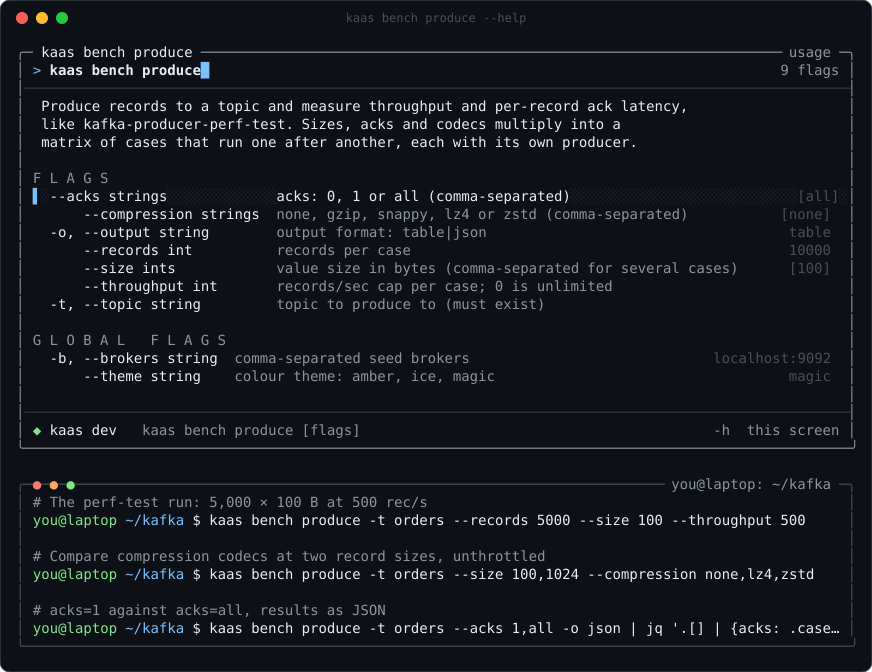

On a pipe, you get cobra's standard plain help instead, so `kaas --help | grep` works as usual.

### Connecting

Before a session opens, `kaas` probes the cluster one layer at a time and shows the progress as a boot log. When the cluster answers, the log is erased. When it doesn't, the log stays, so you can see where it stopped.

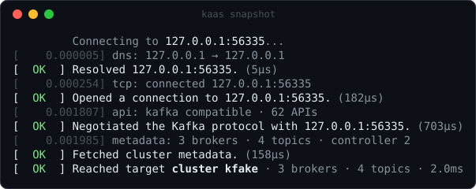

### `kaas`: the terminal UI

Run `kaas` with no command. The first screen lists every topic with its partitions, under-replicated count, records retained and how fresh its offsets are. The cluster's event feed runs underneath.

| Key | Does |
|---|---|
| `↑` `↓` / `j` `k` | Move |
| `enter` | Open the topic: partitions, leaders, replicas, ISR, offsets |
| `esc` | Back |
| `/` | Filter topics (internal topics only when the filter starts with `_`) |
| `:` | Command palette: `:topics`, `:brokers`, `:topic <name>`, or just `:<name>` |
| `?` | Help |
| `ctrl+d` | Request-budget overlay |
| `q` | Quit |

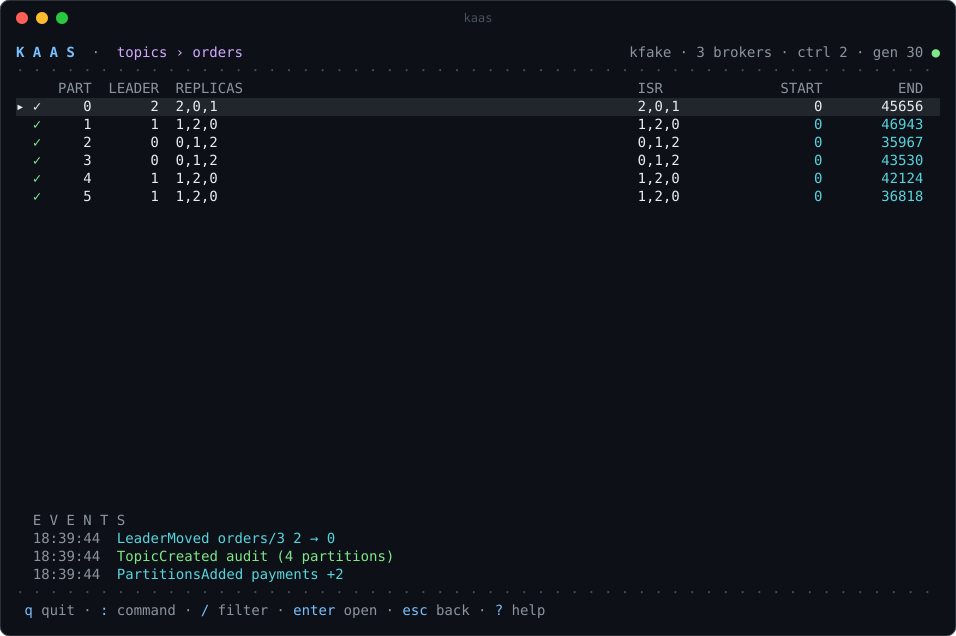

The partition you're looking at is watched closely, with its offsets refreshed every second. Everything else refreshes on a slower interval. `:brokers` shows each broker's leadership load and marks the controller:

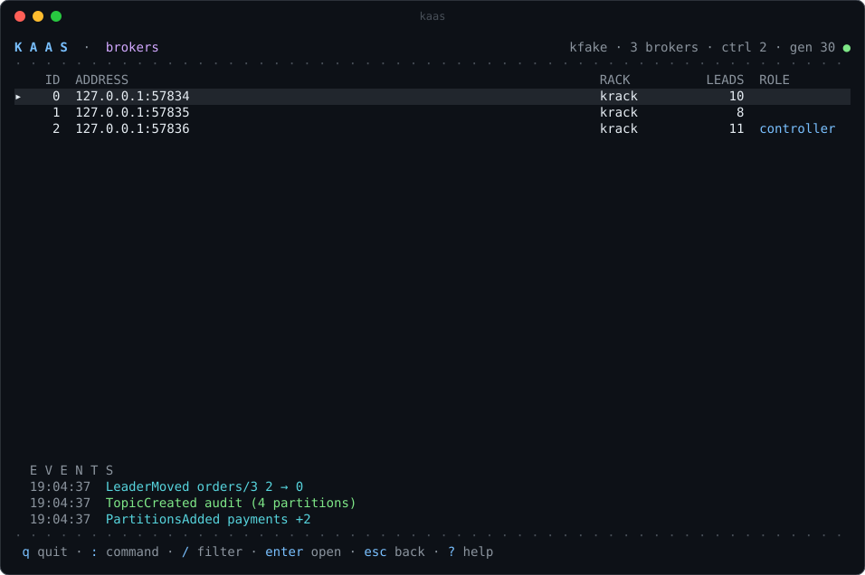

A typo doesn't dead-end. It shows the nearest real names:

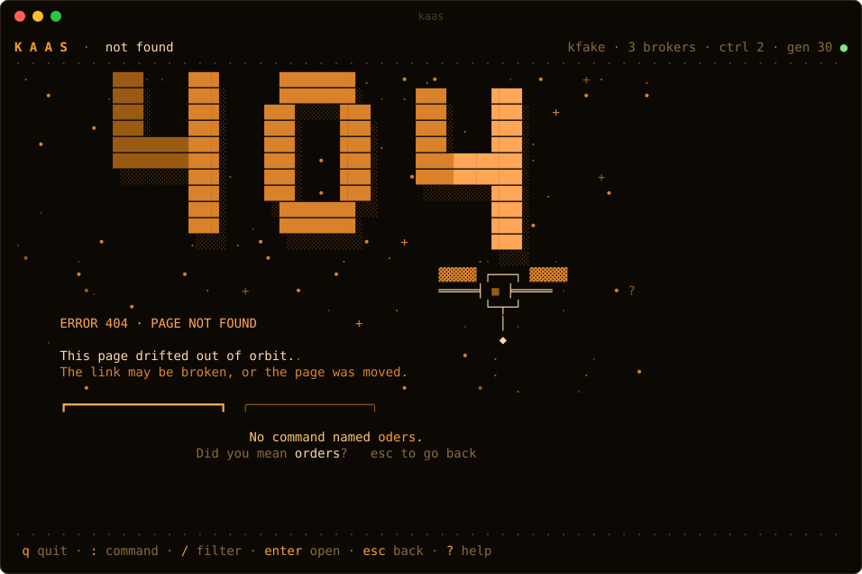

### `kaas watch`: what changed, as it happens

```bash
kaas watch -t orders -t payments
```

Each `-t` topic gets a records-per-second sparkline and its retained count. Cluster events arrive as cards, and each card's bottom edge burns down as it ages: leader moves, ISR shrink and expand, topics and partitions added or deleted, brokers joining or leaving, controller elections. The footer shows the request budget, so you can see what watching costs the cluster.

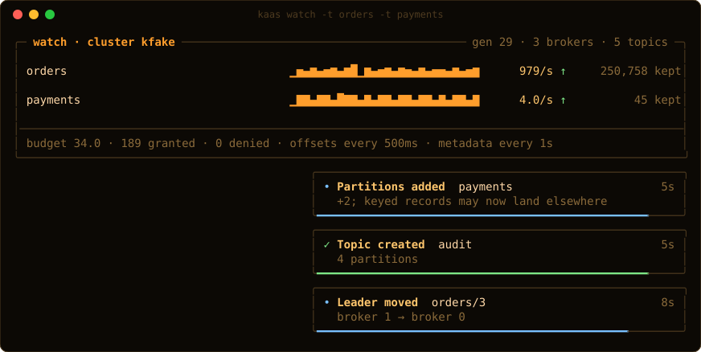

For scripts, use `kaas watch -o json` (one object per line) or pipe the output for plain timestamped lines.

### `kaas snapshot`: one look, for scripts too

```bash
kaas snapshot                  # every topic, problems first
kaas snapshot --sort records   # biggest first (also: name, partitions)
kaas snapshot -o json | jq .   # everything: brokers, topics, partitions, offsets
```

One row per topic: partitions, replication factor, under-replicated and offline partitions, records retained, and a status dot. Offline topics sort first, then under-replicated ones. The strip underneath totals the cluster and draws leaders per broker, so an unbalanced cluster shows at a glance. On narrow terminals the least important columns drop out before anything is cut.

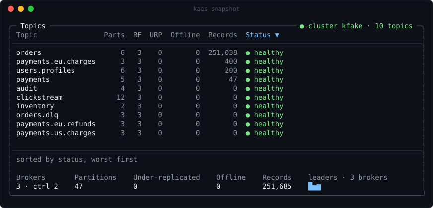

### `kaas topics`: what each topic keeps, and what it costs

```bash
kaas topics                         # every topic, problems first
kaas topics 'payments.*' --sort disk
kaas topics --tree                  # names grouped by prefix
kaas topics --internal              # include __consumer_offsets and friends
```

Each topic shows its partitions and replication factor. It also shows records retained, disk used across every replica, retention and cleanup policy. Retention or cleanup that a topic sets for itself is purple. Grey values are inherited from the broker, so you can spot a topic that quietly keeps data forever.

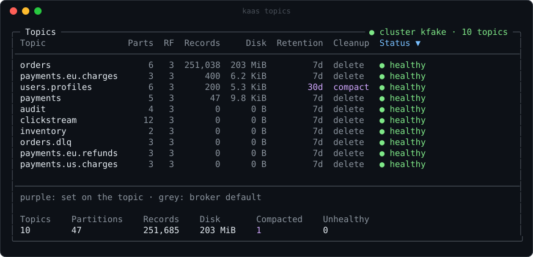

With `--tree`, names split on `.` (or `--sep`) into folders, and single-child chains merge. Each topic is a leaf with its status, size, and a flag: `!` offline, `U` under-replicated, `C` compacted.

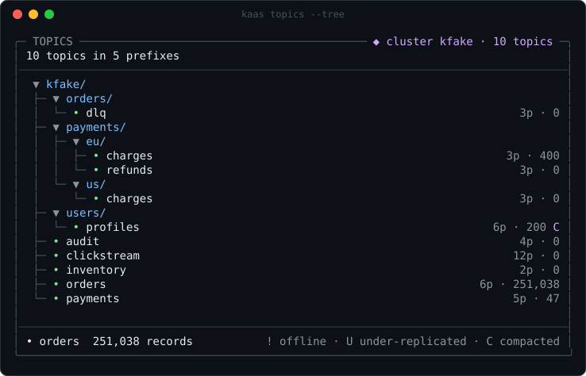

The pattern is a glob. A plain name that isn't a topic gets the 404 page with the closest real names. On a pipe the table prints raw numbers (records, `DISK_BYTES`), so `sort -n` and `awk` work. `-o json` gives `retentionMs`, `cleanupPolicy`, `diskBytes` and the rest per topic.

#### `kaas topics describe`: one topic, partition by partition

```bash
kaas topics describe orders
kaas topics describe orders -o json | jq '.partitions[] | select(.isr | length < 3) | .id'
```

Every partition's leader, replicas, in-sync replicas, offsets, records and size, with `>>` on the one that needs attention (offline, then under-replicated, else the largest). The layout shows one bar per broker: each replica is a segment in its partition's colour, sized by its bytes on that broker. `█` is a leader, `▒` a follower and `░` an out-of-sync replica, so skew and lagging replicas show at a glance. Below are the leader spread, how many partitions are in sync, and the configs the topic sets itself.

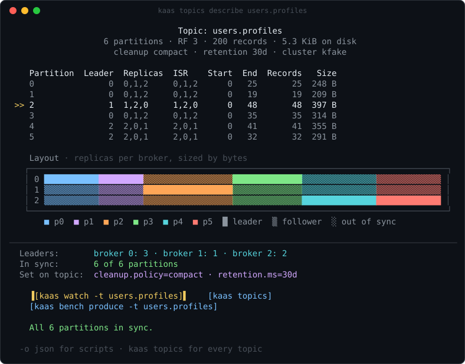

On a pipe it prints the `kafka-topics --describe` layout, so existing `grep` habits still work.

#### `kaas topics create`: make a topic

```bash
kaas topics create                                  # step by step
kaas topics create payments -p 12 -r 3 -c cleanup.policy=compact
kaas topics create payments -p 12 --if-not-exists -o json   # idempotent, for scripts
```

On a terminal without `--partitions`, `create` walks through four steps, each checked before you move on:
1. **Name.** The name is checked against Kafka's rules and the topics you already have, including names that would collide in Kafka's metrics, where `.` and `_` become the same. You also see where the name sits in its family, for example `payments › eu › refunds` and how many topics share `payments.eu`.
2. **Layout.** The partition count and replication factor start from the cluster's own `num.partitions` and `default.replication.factor`, which kaas gets by asking the controller. You see how many replicas that makes per broker, and RF 1 comes with a warning.
3. **Configs.** Retention, cleanup, min in-sync replicas and compression are cards you change with `←` `→`. A card turns green when it differs from the broker.
4. **Create.** The controller checks the whole topic before anything is created. `enter` then creates it, and a bar fills as each partition gets a leader.

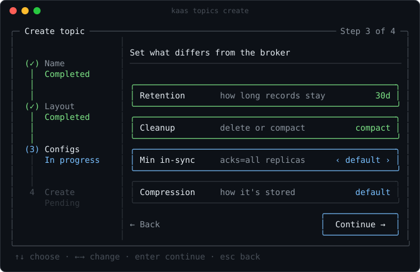

With `--partitions`, or without a terminal, the flags say it all: `-p` and `-r` (0 takes the broker's default) and repeatable `-c key=value`. `--dry-run` has the controller check the topic without creating it. A topic that already exists exits 1, unless you pass `--if-not-exists`. `-o json` gives `{topic, id, partitions, replicationFactor, configs, created, dryRun}`.

#### `kaas topics delete`: remove topics, with a moment to undo

```bash
kaas topics delete orders.v1                 # type the name, then 5s to undo
kaas topics delete orders.v1 orders.v2       # type "delete 2 topics"
kaas topics delete orders.v1 --yes -o json   # scripts: no dialog, no wait
```

Kafka can't bring a deleted topic back, so on a terminal `delete` makes you look before anything happens:
- **The dialog** opens over the topic's own describe page, dimmed, and says what goes with it: the records, the size on disk, the partitions, and the consumer groups still reading it.
- **You type the topic's name** to arm the red button. For several topics you type `delete N topics`.
- **For 5 seconds** the bin stays open with an Undo timer draining. `u` or `esc` cancels, and nothing has been sent yet; `enter` deletes now.
- **Once the window ends**, kaas sends the delete. It waits until the cluster no longer lists the topic before the lid shuts.

<table><tr><td width="62%">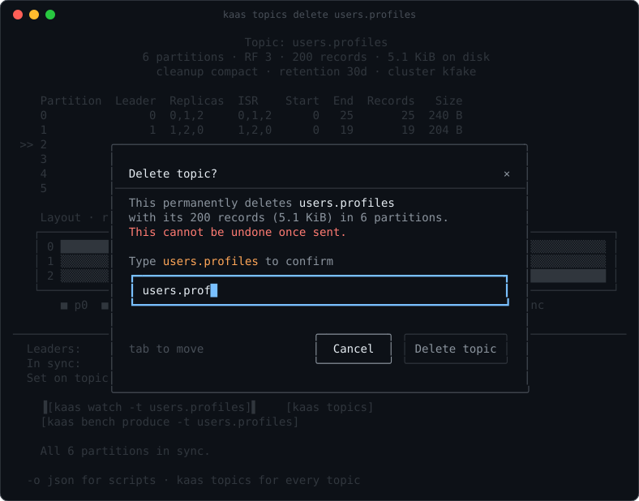</td><td>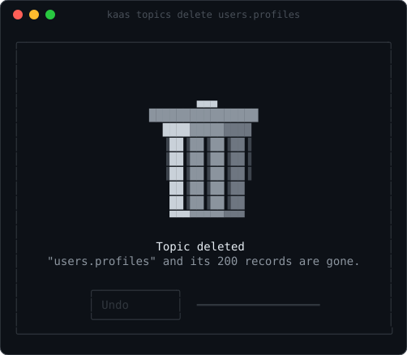</td></tr></table>

Without a terminal to type into, `--yes` is required, and the delete is sent at once. With a terminal but stdout piped, kaas asks for the name on stderr instead of opening the dialog. An unknown topic exits 3. Internal topics such as `__consumer_offsets` are refused (exit 2). If a topic couldn't be deleted, for example because the brokers set `delete.topic.enable=false`, kaas exits 1 with the controller's reason. `-o json` prints `[{topic, deleted, error}]`.

#### `kaas topics alter`: add partitions

```bash
kaas topics alter orders --partitions 12            # preview, type yes, write
kaas topics alter orders --partitions 12 --dry-run  # the controller checks it; nothing is written
kaas topics alter orders --partitions 12 --yes -o json
```

Kafka can add partitions to a topic but never remove them, so `alter` shows the plan before it changes anything. The plan is the describe screen with the new partitions added in green. They have no leader yet because the controller places them when they're written.

Below the table, the plan spells out what changes:
- Keys hash over the new count from then on, so a key's new records can land on a different partition from its old ones.
- The groups reading the topic rebalance to pick up the new partitions.

You type `yes` to write it. The table is then redrawn in place with the new partitions' real leaders and replicas.

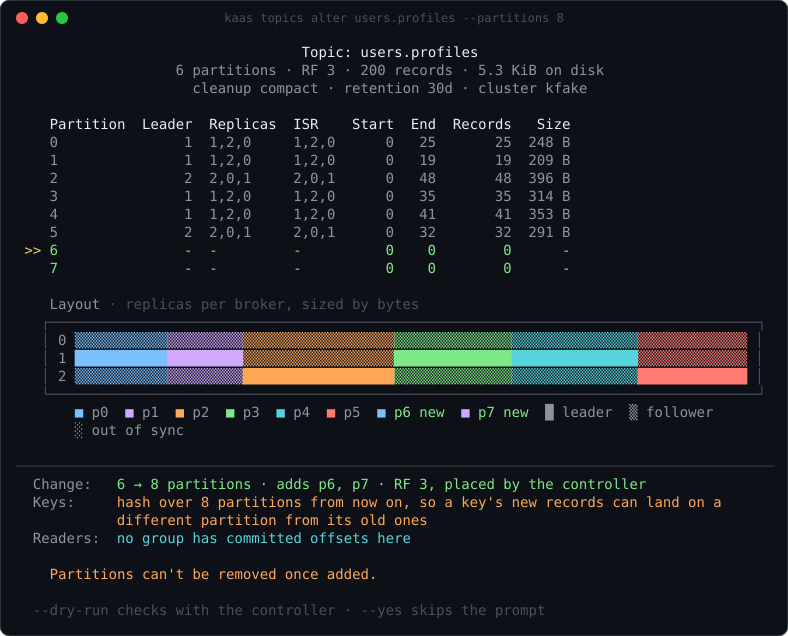

Without a terminal to answer the prompt, `--yes` is required, so a piped `yes` can't confirm by accident. Asking for fewer partitions than the topic has is a usage error (exit 2). Asking for the count it already has does nothing and exits 0, so a script can rerun it safely. On a pipe, it prints one line, such as `orders: 6 → 12 partitions, added 6,7,8,9,10,11`.

### `kaas brokers`: who does the work

The cluster as a process tree: every broker, what it leads, and the topics it leads most.

```bash
kaas brokers            # brokers and their top 5 topics
kaas brokers --top 0    # brokers only
```

Each broker row shows the partitions it leads, the replicas it holds, and its disk use across all log directories. The controller is marked, and replicas out of sync show as `N behind` in orange. A broker that partitions still name but metadata no longer lists is shown in red as `offline`. Leader counts well above the even share turn orange. **Skew** in the footer is the busiest broker's leaders over the even share, where `1.00x` is balanced. Internal topics fold into one row unless you pass `--internal`.

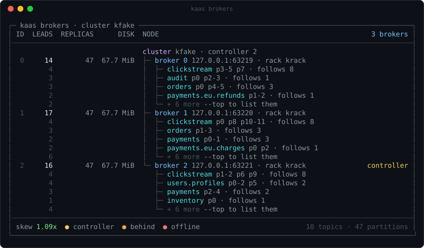

On a pipe it prints one line per broker with a `STATUS` of `controller`, `online` or `offline`. With `-o json` you get every broker's topics with the partition IDs it leads.

### `kaas groups`: who is behind, and for how long

Every consumer group, worst lag first, refreshing in place like a task manager:

```bash
kaas groups                      # live, every 2s; Ctrl-C to stop
kaas groups 'billing-*' --sort rate
kaas groups --once               # one read and exit
```

Each row is a group's state, members, the topics it reads and how many records it is behind, with a bar for its share of the worst lag. The rate comes from committed offsets between refreshes, and **Catch up** is lag divided by rate: `stalled` when its members are not committing, `no members` when nobody is consuming, `caught up` at zero. Rebalancing groups show in purple. Below the rows are the totals and a chart of total lag over time, red wherever it grew.

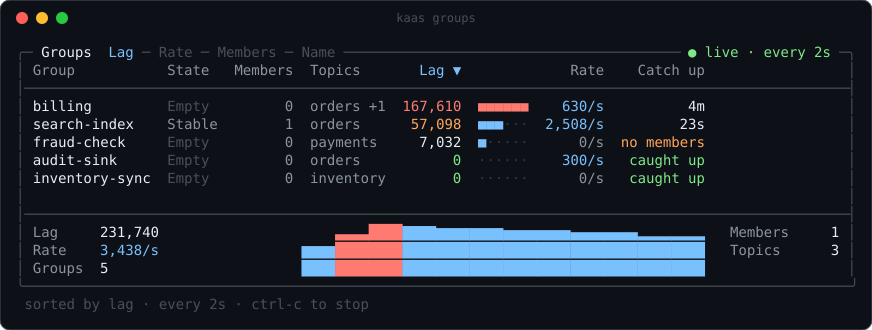

On a pipe it prints one line per group with raw lag numbers. With `-o json` you get every group's lag, committed offsets and topics. A single read has no rate, since the rate needs two reads.

### `kaas lag`: the backlog, ranked

Where `kaas groups` shows each group, `kaas lag` ranks every group·topic pair by how far behind it is:

```bash
kaas lag                    # live board, every 2s
kaas lag 'billing*' --top 5
```

The top three pairs get medals. Each row has a bar for its share of the worst lag, and a trend against three refreshes ago: `▲` in red means the backlog grew, `▼` in green means it shrank. Below the rows, a live chart draws total lag over time with the minimum, average and maximum, and how fast the shown groups consume.

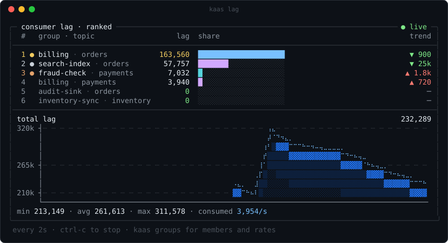

When every group is at the head of its topics, the board turns into this:

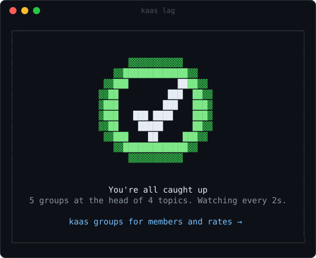

With `-o json` you get `[{group, topic, lag}]`, worst first. That makes a deploy gate a one-liner:

```bash
test "$(kaas lag -o json | jq '[.[].lag] | add // 0')" -eq 0
```

### `kaas offsets reset`: read again, or skip ahead

```bash
kaas offsets reset                                    # ask for each piece
kaas offsets reset billing -t orders --to 2h          # read the last two hours again
kaas offsets reset billing --all-topics --to latest   # skip the backlog
kaas offsets reset billing -t orders --to -500 --dry-run
```

`--to` takes `earliest` or `latest`, an offset (`1043`), a shift from the committed offset (`+100`, `-500`), a time (`2026-10-31T09:00`, local unless it names a zone), or how long ago (`90m`, `2h`, `7d`). Time targets ask the cluster for each partition's first record at or after that moment, the way a consumer would. A target past either end of a partition's log is moved to that end, as the broker requires, and the plan marks it `clamped`.

On a terminal, anything the flags leave out is asked for in a stepper. First you pick the group from a list showing state, topics and lag. A group with members can't be picked. Then you tick its topics and choose where to. The last step asks the cluster for the plan and sums it up before showing it in full.

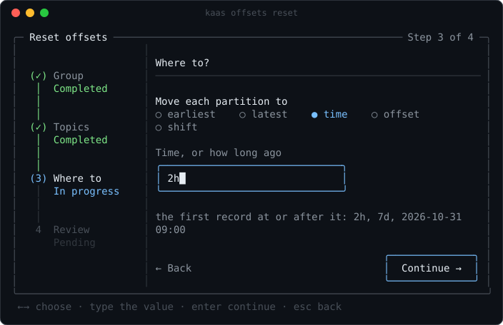

The plan follows the infra-plan-diff layout. `~` is a committed offset that moves, old in red and new in green, with how many records the group reads again or skips. `+` is a partition the group has never committed, which gets its first offset. A partition that doesn't move is counted, not listed. Nothing is committed until you type `yes`. The commit lines that follow are the coordinator's actual answers, and a partition it refuses is named.

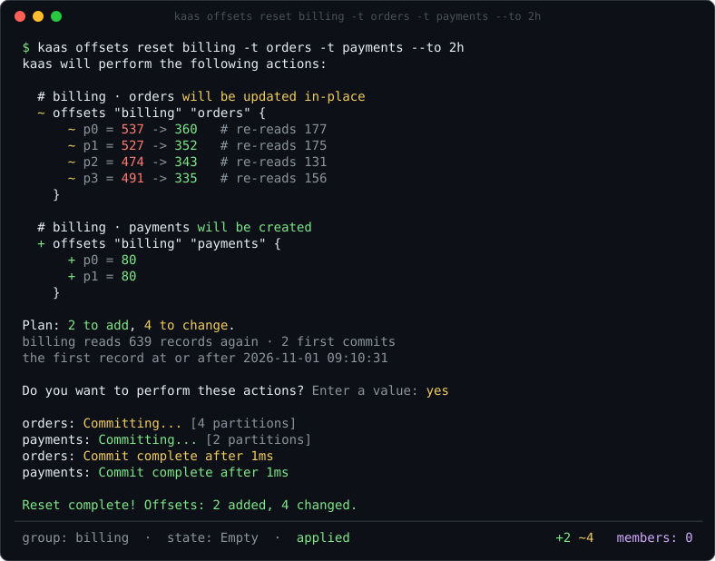

Kafka only takes commits from a group with no members, so kaas checks first. A group that is in use stops with who its members are, and nothing is sent. A group name kaas doesn't know is planned as new, all `+`, so a typo shows up in the plan before you confirm. Without a terminal, `--yes` is required. `-o json` prints `{group, state, to, dryRun, applied, moves}`, where each move has `from` (null before a first commit), `to`, and `change` (`add`, `change`, `same` or `skip`).

### `kaas offsets find`: where a moment, or a problem, starts

```bash
kaas offsets find orders --time 2026-10-31T09:00     # every partition
kaas offsets find orders --time 2h -p 0
kaas offsets find orders --match '"version":2'       # the first record with the new schema
```

`kaas offsets find` bisects each partition. It reads the record in the middle of what's left, keeps the half the answer is in, and repeats, so 12,480 records take about 14 reads. Each read is one Fetch from the partition's leader. Nothing is consumed or committed. The rail shows each read as it lands, green for before and red for at or after, with a bracket under what's left. The log under the rail shows every read: its offset, time, how long it took, and the record.

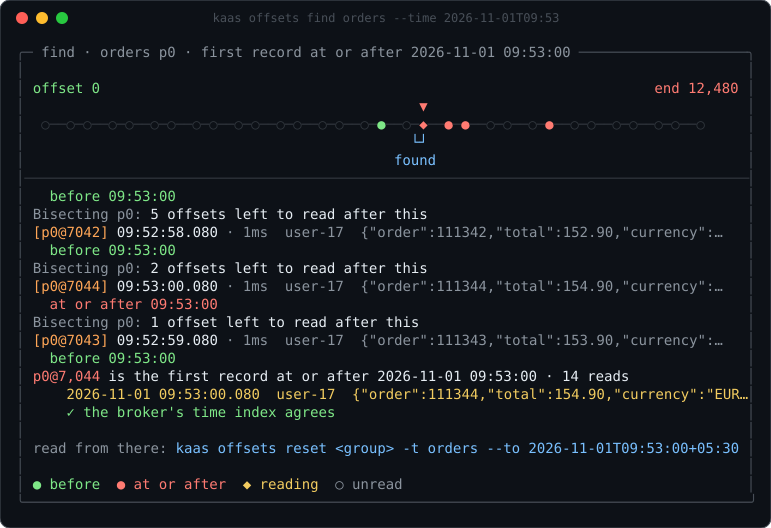

With `--time`, kaas also asks the broker's time index the same question. They agree unless producers stamped records out of order, and then kaas tells you so. The last line is the `kaas offsets reset` command that starts a group reading from that moment.

`--match` finds the first record whose value matches a regular expression, for questions like "where did the bad records start". A bisect assumes that once records match, they keep matching. So kaas reads the next three records, and if one of them doesn't match, it warns that there may be earlier matches.

A pipe prints `topic partition offset timestamp` per partition, or `-` when nothing qualifies. `-o json` adds `reads` and, for `--time`, the broker's `indexOffset`.

### `kaas consume`: read a topic like a channel

```bash
kaas consume orders                       # new records as they arrive
kaas consume orders --from -20            # the last 20 of each partition, then follow
kaas consume orders --from 1h -p 2 --exit # the last hour of partition 2, then stop
```

Each record is a line, the way a chat channel shows messages: its time, its partition and offset, its key in its partition's colour, then its value, which wraps under itself. Lines that open with `-->` show where each partition starts and how far behind its end that is. A tombstone shows in red, and headers show in purple under their record. Binary values show as their size, so they never garble the terminal. The panel on the right counts records per partition.

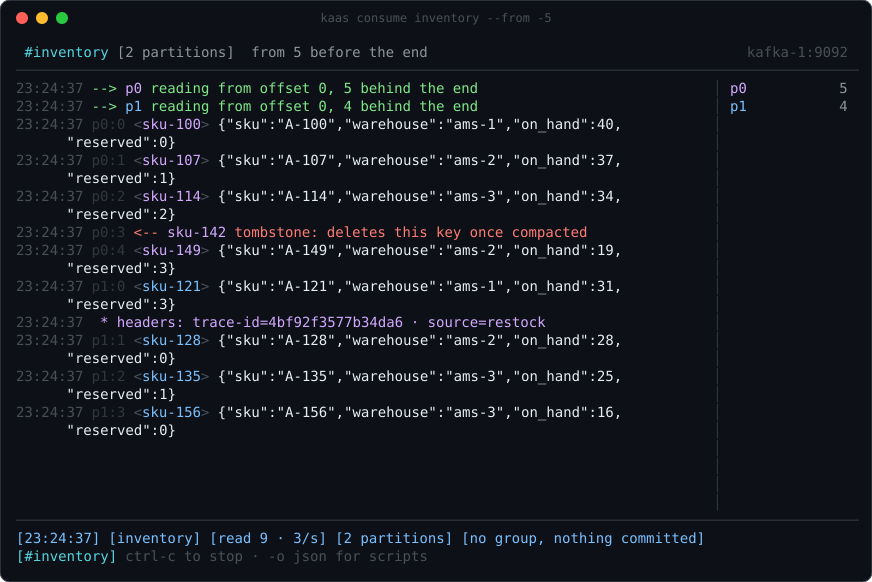

`kaas consume` never joins a consumer group and never commits, so reading never moves anyone's offsets. `--from` takes `end` (the default), `beginning`, `-N`, a duration like `15m`, or an RFC 3339 time. `-n` stops after a number of records, and `--exit` stops at the end each partition had when the read began.

On a pipe it prints one raw value per line, like `kafka-console-consumer`. With `-o json` you get one object per line: `partition`, `offset`, `timestamp`, `key`, `value` and `headers`, with binary keys and values base64-encoded and marked as such. `kaas tail` is the same command.

#### A time window: `--to` and `--pick`

```bash
kaas consume orders --from 2026-10-26T00:00:00Z --to 2026-10-31T00:00:00Z
kaas consume orders --from 3h --to 1h -o json > window.jsonl
kaas consume orders --pick
```

`--to` stops each partition before its first record at or after a time, so a window reads exactly what it holds and then exits. It needs a `--from` time (a duration or an RFC 3339 time) that comes before it, and it can't be in the future.

`--pick` opens a calendar of two months to choose the days instead. Days before the oldest record the topic keeps, and days after today, are faint and can't be picked; days that hold nothing are dimmed. Move with the arrows, press enter on the first day and on the last, and the footer shows how many records the window holds, counted from the broker's time index rather than guessed. Enter again reads it in the channel view. A `--from` and `--to` given with `--pick` start the calendar on that window.

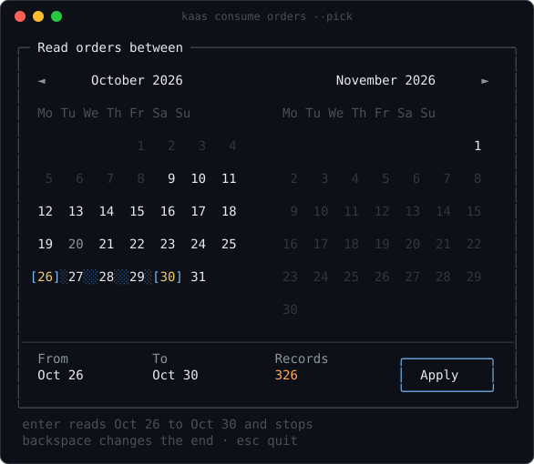

### `kaas clients`: who is reading and writing

```bash
kaas clients                 # live, busiest first
kaas clients 'billing*'      # by client.id, group, transactional.id or topic
kaas clients --once --all    # one read, idle producers included
```

This uses the same task-manager frame as `kaas groups`, with one row per client the cluster can see.

- **Consumers** are consumer group members. Each row shows its `client.id`, the host the broker saw, its group, how many partitions it's assigned, and how far behind it is.
- **Producers** are idempotent or transactional producers, from `DescribeProducers` (KIP-664). A transactional producer is shown by its `transactional.id`; any other producer by its producer ID. Its status is `writing`, `in txn`, or how long it has been idle.

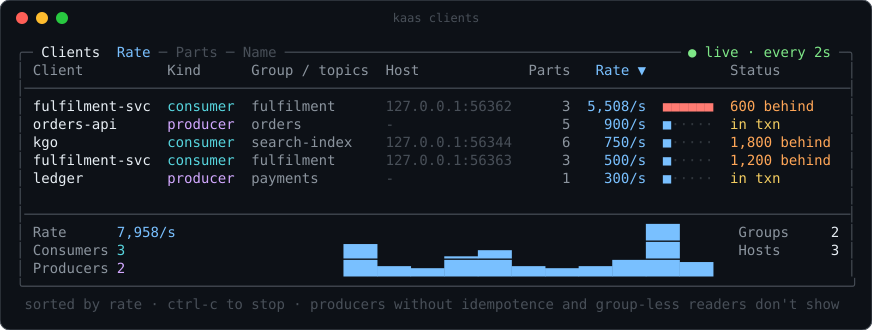

Kafka has no API that lists connections or request rates; those live only in broker JMX metrics. So the rate here is records per second, measured between two refreshes: a member's offset commits, and a producer's sequence numbers (which count records). A member's rate comes in steps because most clients commit every 5s, so it reads `0/s` between commits and then catches up. Rates are only compared on partitions a client had in both refreshes, so a rebalance doesn't show up as a burst. A single read (`--once`, a pipe, or `-o json`) has no rates.

Some clients never show:

- **Producers with idempotence turned off.** It's on by default in current clients.
- **Readers without a group,** including `kaas consume`.

Kafka keeps a producer's state for `producer.id.expiration.ms` (a day by default), so producers that haven't written for 10 minutes are hidden unless you pass `--all`.

### `kaas top`: which partitions are working

```bash
kaas top                            # live, busiest writers first
kaas top 'payments.*' --sort bytes  # the payments topics, by disk growth
kaas top --once --top 10            # two readings, then print the top 10
```

This is htop for partitions. Each broker gets a meter showing its share of the records written. The `Read` gauge compares records read with records written, summed over groups: two groups keeping pace read `2.0×`. Below that, every partition has a row:

- `IN/s`: records written, from its log-end offset.
- `OUT/s`: records read, from consumer group commits.
- `BYTES/s`: how fast its log grows on the leader.
- `SIZE`: the log's size on the leader.

The sorted column is marked `▐ ▼`, and the busiest row is yellow. `--sort` takes `in` (the default), `out`, `bytes`, `size`, or `partition`.

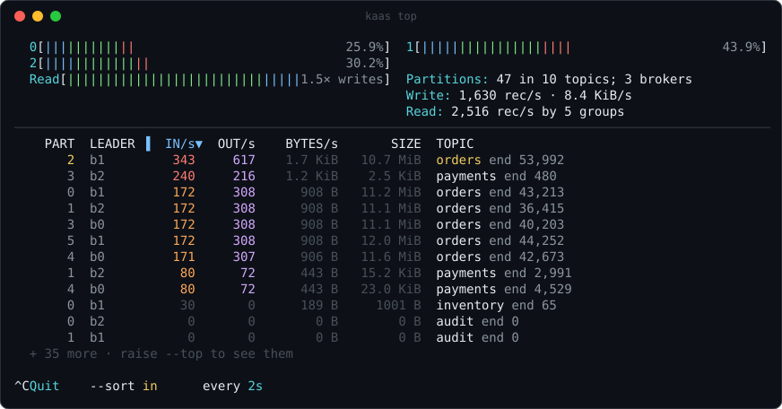

Rates are the difference between two readings, so the first live frame shows `-` until the second reading. `--once`, a pipe, and `-o json` all wait one `--interval` (2s by default) for that second reading before printing. The JSON has one object per partition: `topic`, `partition`, `leader`, `in_per_sec`, `out_per_sec`, `bytes_per_sec`, `size_bytes`, and `end_offset`. A negative value means unknown, for example when the cluster refuses `DescribeLogDirs`. `OUT/s` counts only groups that commit; `kaas consume` never commits, so its reads don't show up here.

### `kaas sniff`: watch the requests clients send

```bash
kaas sniff                                   # a proxy on localhost:19092
kaas consume orders --brokers localhost:19092  # in another terminal: read through it
kaas sniff --api produce --api fetch         # only some requests
kaas sniff -n 100 -o json | jq -r .api       # the first 100, for scripts
```

`kaas sniff` runs a proxy in front of the cluster. Point a client at its `--listen` address instead of a broker, and every request it sends shows up as a line: when it came, the client's address, the broker it went to, its API in that API's colour, its size, and what it asks for, decoded (`orders p0,p2 · 24 records · acks all` for a produce, `orders p0@1200` for a fetch, `billing · generation 3` for a heartbeat). Produce is orange, fetch blue, metadata yellow, offsets cyan, groups purple, transactions green, and requests that change the cluster red.

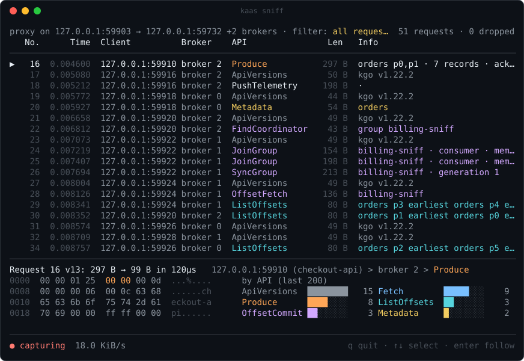

↑ and ↓ select a request: the panel below shows its version, its size and its answer's, how long the broker took, which client sent it, and its first 32 bytes, with the API key highlighted. Enter follows the newest again. The bars count the last 200 requests by API.

Each broker gets a listener of its own, on the ports after `--listen`'s. The proxy rewrites the broker addresses in the answers that carry them (Metadata, FindCoordinator, DescribeCluster, and the leader hints in newer Produce and Fetch answers) so a client's later connections come through it too. Everything else is forwarded as it came. Clients that don't use the proxy aren't touched. When the screen falls behind a busy client it counts requests as dropped from the screen; it never slows the traffic.

On a pipe each request is a line, and `-o json` gives `n`, `time`, `client`, `client_id`, `broker`, `api`, `key`, `version`, `bytes`, `response_bytes`, `took_ms`, `answered` and `info`.

`--client-id` keeps only the requests from clients with that client ID.

#### Where a client's time goes: `--trace`

```bash
kaas sniff --trace --client-id billing-svc       # its first 10 seconds
kaas sniff --trace --for 30s -o json > trace.jsonl
```

`--trace` starts with the first request through the proxy and records `--for` (10 seconds by default), then stops and keeps the waterfall on screen. Each request is a bar on one time axis, split into the stages the proxy sees:

- **connect**: dialing the broker, on a connection's first request
- **send**: the request's bytes, in from the client and on to the broker
- **queue**: waiting behind earlier requests on the same connection, which a broker answers in order
- **wait**: the broker working on it, a fetch's long poll included
- **ack**: the answer's bytes, back to the client

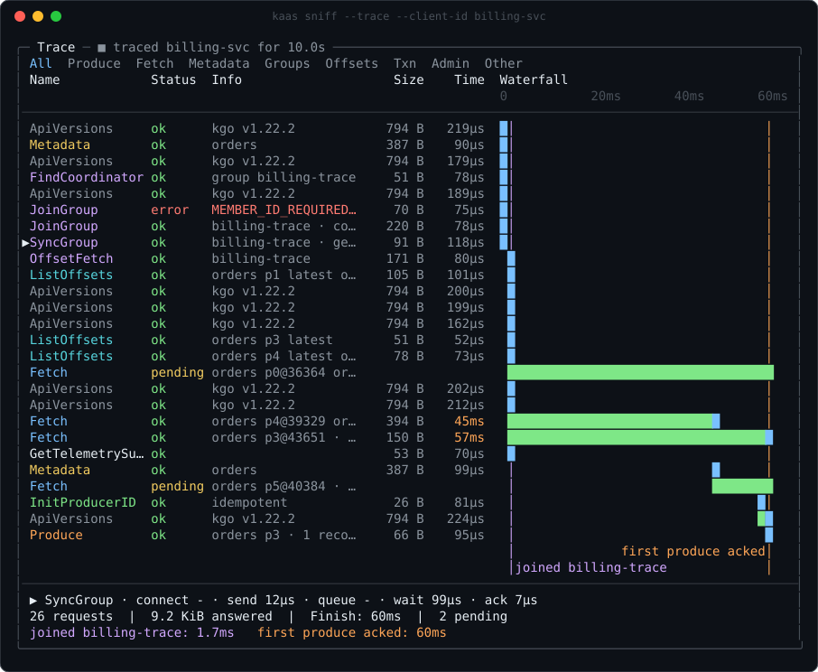

A request whose answer carries an error, such as the `MEMBER_ID_REQUIRED` a first JoinGroup gets, shows as `error` in red with the error's name. Lines mark when the client's group was joined and when its first produce was acknowledged. ↑↓ select a request to read its stages in the footer, ←→ switch between kinds (produce, fetch, metadata, groups, offsets, transactions, admin), and enter follows the newest. On a pipe each answered request is a line, and `-o json` gives each stage in milliseconds since the trace's first request.

#### Where the time goes: `--profile`

```bash
kaas sniff --profile                              # until q
kaas sniff --profile --api produce --api fetch    # only those
kaas sniff --profile --for 1m > kafka.folded      # folded stacks, for speedscope or flamegraph.pl
```

`--profile` adds every request's stages up into a flame graph: all at the bottom, then each API, the broker it went to, its topic, and its stages on top, each frame as wide as its share of the time. ←→ move between frames side by side, ↑ goes up the stack and ↓ back down, and the footer shows the selected frame's share of the time, how many requests went through it, and their average and p99. Enter zooms into a frame, esc zooms back out, and r starts over.

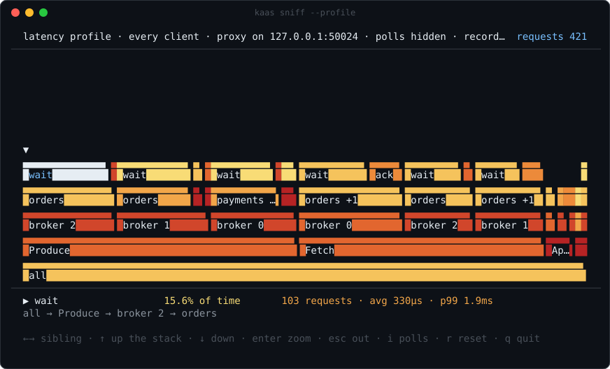

A fetch can spend its time polling rather than serving: a consumer that has caught up asks for records that don't exist yet, and the broker holds the fetch until some are written or its wait runs out. The profile tells the two apart. A fetch answered with nothing spent all its wait as an `idle poll`. A fetch whose first record was written after the fetch reached the broker spent the time until then as a `long poll`, going by the records' timestamps. Both are hidden at first, so the graph shows the time spent serving. Press i to show them.

`--profile` records until q, or for `--for` when you give it. On a pipe it prints the profile when it ends, as folded stacks (one line per stage with its time in microseconds), or as a tree with `-o json`.

### `kaas segments`: what a partition's log holds

```bash
kaas segments orders                  # the partition with the most bytes on disk
kaas segments users -p 3              # a compacted topic's partition 3
kaas segments orders --budget 1GB     # read up to 1GB whole rather than sampling
kaas segments orders -o json | jq '{density, holes}'
```

`kaas segments` maps one partition's log as a grid of cells, each a range of offsets from the log start to the end, read from the record batches the leader serves. A cell is solid where every offset still holds a record and thins out (▓▒░) where compaction removed some. A dot is a hole, offsets no batch covers. Colours say what the batches hold: plain records, transactions that committed or aborted, ones still open, and the markers that end them.

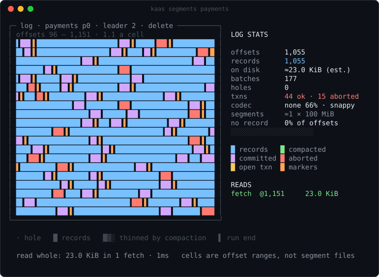

The panel adds the records, the bytes on disk (from the broker's log dirs, or estimated from the first batches when it won't say), the batches, the holes and the largest, the transactions, the codecs, and roughly how many segment files that makes at the topic's `segment.bytes`. Kafka doesn't show segment files over its protocol, so the map is by offset, not by file.

A log that fits in `--budget` (64MB by default) is read whole. A bigger one is sampled, one small fetch a cell: then the records are an estimate and holes can't be counted. Nothing is consumed or committed. On a pipe it prints a line per stat, and `-o json` adds every cell.

### `kaas config`: what a topic or broker is set to

```bash
kaas config orders                 # every config, in sections
kaas config orders --set           # only what isn't Kafka's default
kaas config --broker 1             # a broker's
kaas config orders -o json | jq '.[] | select(.source == "topic")'
```

`kaas config` lists a topic's configs under retention, cleanup, segments, messages and replication, or a broker's with `--broker`. A value that isn't Kafka's default is drawn bright and tagged with where it is set: `topic`, a `broker` override the topic inherits, a `cluster`-wide default, or the broker's server.properties (`file`). Switches show true and false. Durations sit on a slider from a second to a year, sizes from a kilobyte to a terabyte, and `min.insync.replicas` against the replication factor, so an outlier stands out.

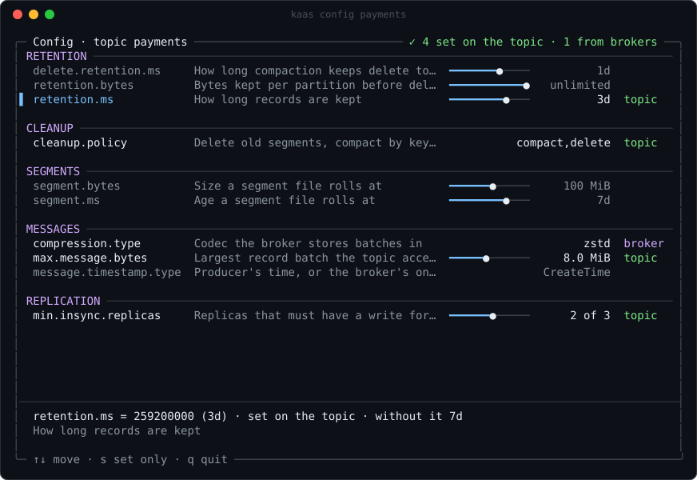

↑↓ move, and the foot shows the selected config's value, where it comes from, what it would be without it, and the broker's documentation for it. `s` shows only what is set, and q quits. On a pipe it prints a line per config with its source; `-o json` adds the default and section. Sensitive values, such as passwords, are never shown.

#### Changing configs: `kaas config edit`

```bash
kaas config edit orders                     # in the editor
kaas config edit --broker 1                 # a broker's dynamic configs
kaas config edit orders --set retention.ms=3d --unset cleanup.policy --dry-run
kaas config edit orders --set retention.ms=3d -o json
```

`kaas config edit` opens the configs as a file, one `key = value` a line under the same sections. A line without `#` is set on the topic (or dynamically on the broker). Comment it out or delete it to go back to the default. Durations take `3d`, `12h` or `500ms`, and sizes `1GiB`, as well as Kafka's own numbers.

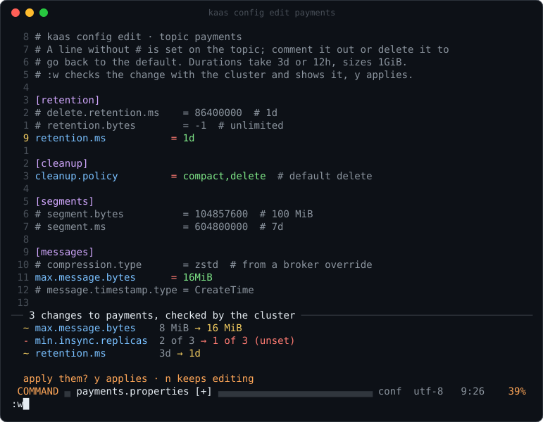

The editor is modal, as vi is:
- **Insert:** `i`, `a`, `o` and `O`; Esc goes back to normal mode.
- **Move:** `h j k l`, `w b`, `0 $` and `gg G`.
- **Delete and change:** `x`, `dd` and `D` delete; `cw` changes a word; `u` undoes.

`:w` checks every change with the cluster without applying it, then shows them: `~` changed, `+` set, `-` unset and what it falls back to. `y` applies them and `n` keeps editing. A key the cluster doesn't list is refused with the nearest real one, and so is a read-only key. Other commands:
- `:wq` applies and quits.
- `:q!` leaves without applying.
- `:e!` starts over from what the cluster has.
- `:%s/old/new/g` replaces text.

For a script, `--set key=value` and `--unset key` make the change without the editor, `--dry-run` only checks it, and `-o json` lists the changes.

### `kaas produce`: write records

```bash
kaas produce orders                                   # compose one in the editor
kaas produce orders -k user-17 --value '{"order":1043}' -H source=cli
kaas produce orders --key-separator ':' < orders.txt  # one record per line
```

On a terminal, with nothing piped in, `kaas produce` opens an editor. The value, key and headers each get a tab, and `tab` moves between them. JSON is highlighted as you type: keys in purple, strings in light blue, numbers and literals in blue. `enter` keeps your indentation and indents after `{` or `[`, and a closing bracket steps back out.

The status bar checks the value as you type and points at the first problem by line and column. `ctrl-s` refuses to send until the problem is fixed. A pretty-printed JSON value is sent compacted, so the stored record has no editor newlines. After a send, the buffers stay as they are and the status bar shows where the record landed, so you can change one field and send again. When you quit, each send is printed as a line.

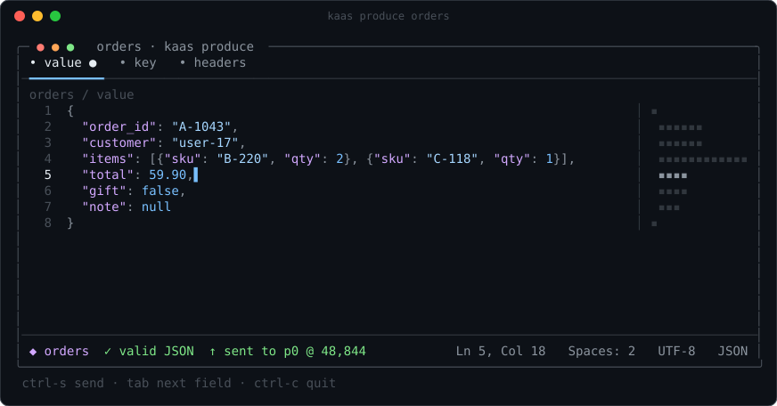

On a pipe, each line is one record, the way `kafka-console-producer` reads them. With `--key-separator`, the text before the separator is the key; a line without the separator is an error that names the line, so a record never silently loses its key. `--value` sends one record without reading stdin. `-H key=value` adds a header to every record, and `-p` picks the partition. Pipe output is silent unless you pass `-o json`, which prints `{topic, partition, offset, timestamp}` for each record.

### `kaas produce --file`: upload files

```bash
kaas produce orders -f orders-2026-10.jsonl -f orders-2026-11.jsonl
kaas produce orders --key-separator ':' -f refunds.txt -o json > receipts.jsonl
```

`-f` sends each line of a file as a record, with the same rules as a pipe: `--key-separator`, `-H` and `-p` apply to every line, a trailing `\r` is dropped, and a line can be up to 16 MiB. Repeat `-f` for more files. Four files send at a time, the rest wait in the queue.

On a terminal, each file gets a row: how much has been read and sent, its records per second, and a bar. The bar measures bytes actually read, not a guess from line counts. When every file is in, the list turns into the tray, which shows the file count, total size and records, and the `kaas consume` to read them back. `ctrl-c` stops and leaves the list where it was. Records already sent stay sent.

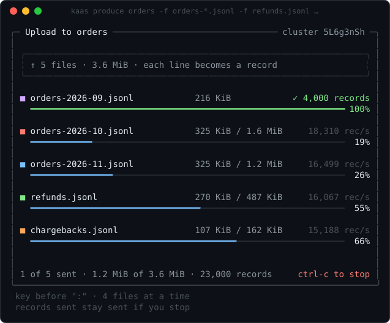

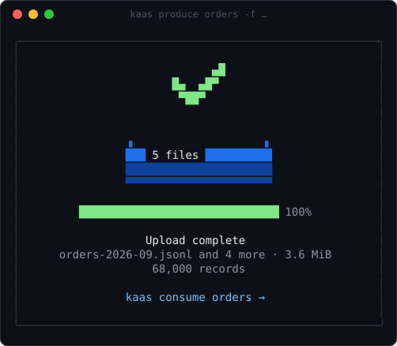

A file that fails does not stop the others. The tray turns red and names the failed file and why, and `kaas` exits 1. A missing file, a directory, or `--value` with `-f` is a usage error (exit 2) before anything is sent. A pipe prints `path: N records` per file. `-o json` prints one object per record with `file` and `line` added, so each record can be traced back to its source.

### `kaas bench produce`: measure, don't guess

The kaas version of `kafka-producer-perf-test`, as a matrix:

```bash
kaas bench produce -t orders --size 100,1024 --acks 1,all --compression none,lz4
```

Every combination runs with its own producer. The table fills in case by case, with a live counter on the running case, a latency histogram and a throughput chart.

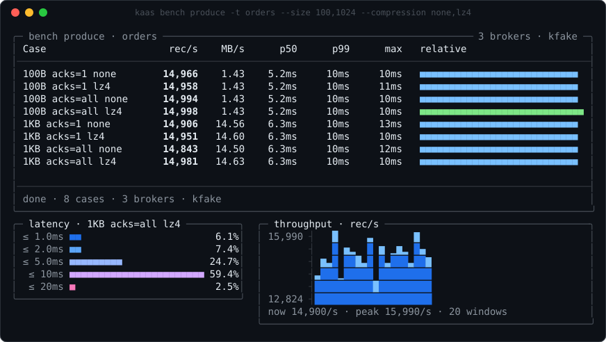

- **Accurate first records.** Each case sends one untimed warm-up record, so connection and producer-ID setup don't inflate the first latencies.
- **Rate cap.** `--throughput` caps records per second, like the perf tool.
- **On a pipe:** one summary line per case, in the perf tool's terms.
- **With `-o json`:** every percentile and the full histogram.

### `kaas bench consume`: the read side

The kaas version of `kafka-consumer-perf-test`. Fetch sizes and waits multiply into cases, the same way:

```bash
kaas bench consume -t orders --records 100000 --fetch-size 64KB,1MB,8MB --max-wait 100ms,500ms
```

Each case reads from the beginning of the topic with its own client, so no case is served from another case's buffer. It never joins a group and never commits. A case reads `--records`, or the whole topic if it holds fewer. If the topic is empty, `kaas bench produce` fills it.

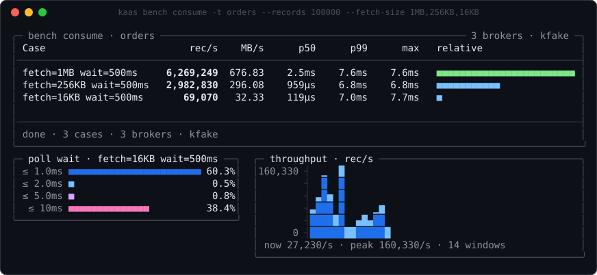

The latencies here are poll waits: how long the reader waited for each batch. A poll served from data already fetched takes microseconds, and one that waits on the broker takes a round trip. Small fetches show more of the second kind. `--fetch-size` takes sizes like `64KB` or `1MB` per partition. On a pipe you get one line per case, and with `-o json` you get the full results, including `polls`.

### When something is wrong

Errors are screens too, and each one says what to do next.

**Cluster unreachable.** One row per seed broker, with a dot for each probe layer. The headline is the layer that broke:

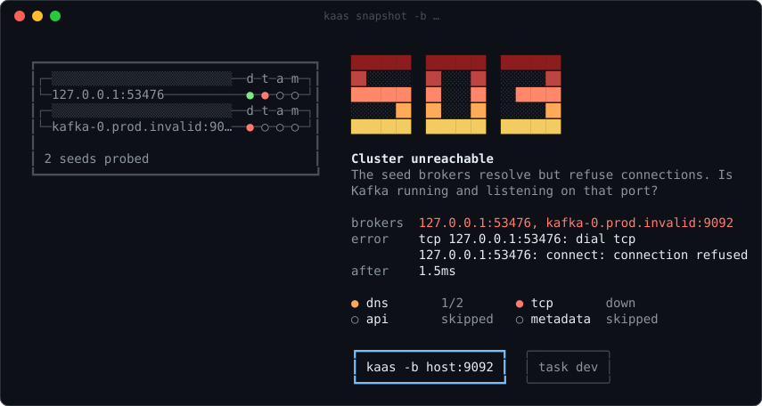

**A name that doesn't exist.** The closest real names come from the live cluster:

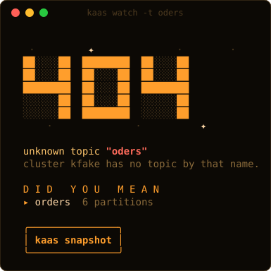

**A bad flag or value.** The flags you set, the bad one highlighted, and why:

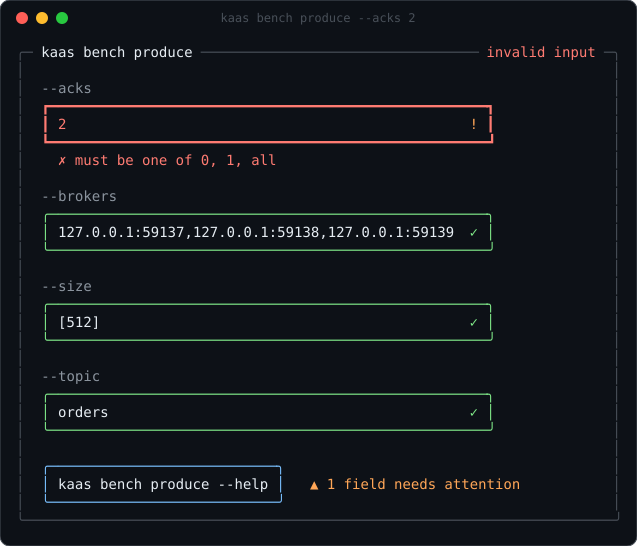

### Output and exit codes

| Where output goes | What you get |
|---|---|
| A terminal | The screens above |
| A terminal with `NO_COLOR` | The same layout, monochrome |
| A pipe, a file, `TERM=dumb` | Plain text: results, or `kaas: <message>` plus `hint:` lines |
| `-o json` | JSON results; errors as `{"error":{"code","exit","message","hints","detail"}}` |

| Exit code | Meaning |
|---|---|
| `0` | Success |
| `1` | Unclassified failure |
| `2` | Usage: a bad flag or argument |
| `3` | Not found: a command, topic or group that doesn't exist |
| `4` | Unavailable: the cluster could not be reached |
| `130` | Interrupted |

### Configuration

| Setting | Flag | Environment | Default |
|---|---|---|---|
| Seed brokers | `-b`, `--brokers` | `KAAS_BROKERS` | `localhost:9092` |
| Theme | `--theme magic\|amber\|ice` | `KAAS_THEME` | `magic`: the colours of the original ascii-magic pieces |
| No colour | | `NO_COLOR=1` | |
| No animation | | `KAAS_REDUCED_MOTION=1` | |

### Troubleshooting

| The probe stops at | It means | Try |
|---|---|---|
| **dns** | The host name doesn't resolve | Check `--brokers`, VPN, `/etc/hosts` |
| **tcp** (refused) | Nothing is listening there | Is Kafka up? Is it the right port? For kind: `task dev:forward` |
| **api** (no answer in time) | Connected, but the broker didn't respond | The broker may be starting, overloaded or cut off from its controller |
| **api** (protocol error) | Something answered, but not as Kafka | Wrong port, or the listener needs TLS/SASL |
| **metadata** | Brokers answered but metadata didn't | Controller trouble; check broker logs |

---

## What's coming

Each upcoming command already has its screen designed: 75 of ascii-magic's 79 UI layouts are assigned to commands. See them all, side by side with the screens already built, in the [screen gallery](SCREENS.md). Highlights:

| Command | Screen |
|---|---|
| `kaas doctor` | A dot per health check, then per-topic health bars |
| `kaas plan` / `apply` | A plan diff of topics, ACLs and quotas, then a rolling apply with an abort countdown |
| `kaas reassign` | A download-queue view of every partition move, with speed and ETA |
| `kaas cluster roll` | A broker-by-broker restart gated on ISR, with a maintenance page for clients |
| `kaas fleet` | Every cluster's status at a glance |

---

## For contributors

```bash
task test           # unit, property and kfake tests (race detector on)
task lint           # golangci-lint, including the core/ import boundary
task screenshots    # regenerate every image on this page from real runs
```

Architecture decisions live in [docs/adr](adr/), and the screen design system in [ADR-0007](adr/0007-command-screens.md). Screen layouts are Go ports of [ascii-magic](https://www.ascii-magic.com/ascii) UI pieces (MIT).

*Apache Kafka is a trademark of the Apache Software Foundation. KaaS is not affiliated with or endorsed by the ASF.*
