# Screen gallery: all 79 UI pieces

Every `kaas` command draws its own screen, and each screen is a Go port of one piece from ascii-magic's **UI** category, filled with live cluster data. This page shows all 79 pieces, the command each one belongs to, and, where the screen is built, the real kaas screen beside the piece it came from.

- The mapping comes from [design 0002](design/0002-command-screens.md); this page is generated from it.
- Piece stills: `node tools/asciipack/stills.mjs docs/img/ui`. Page: `node tools/asciipack/gallery.mjs docs`. Both run under `task gallery`.
- kaas screens: `task screenshots`, real runs against an in-memory Kafka cluster.
- Each piece name links to its animated original on [ascii-magic.com](https://www.ascii-magic.com/ascii) (MIT).

**Status:** built 17 · Phase 1, 2, 3 = which product phase builds it · unused = no honest Kafka fit.

## Index

| Piece | Command or state | Status |
|---|---|---|
| [Command Palette](#command-palette) | `--help` and `kaas help <cmd>`: the command's subcommands and flags | built |
| [Terminal Session](#terminal-session) | Examples under every help screen | built |
| [Boot Sequence](#boot-sequence) | Connecting: DNS → TCP → ApiVersions → Metadata, with timings | built |
| [Server Error 500](#server-error-500) | Cluster unreachable (503), internal error (500): per-seed probe rack | built |
| [Lost In Space 404](#lost-in-space-404) | Unknown command, topic, group or context, with "did you mean" | built |
| [Form Validation Errors](#form-validation-errors) | Bad flags and values, the bad one highlighted with the reason | built |
| [Modal Dialog](#modal-dialog) | Destructive confirm: type the name to delete a topic, group or records, `kaas topics delete` | P1 |
| [Progress Loader](#progress-loader) | Multi-partition progress (delete records, offset resets) | P1 |
| [Spinner Set](#spinner-set) | One spinner for short waits; `KAAS_REDUCED_MOTION` freezes it | P1 |
| [Skeleton Loader](#skeleton-loader) | TUI screens before the first snapshot arrives | P1 |
| [Keyboard Keypress](#keyboard-keypress) | TUI `?` overlay: the keys light up as you press them | P1 |
| [Split Pane Multiplexer](#split-pane-multiplexer) | `kaas` / `kaas tui` | built |
| [Window Tiling Manager](#window-tiling-manager) | `kaas` / `kaas tui` | P1 |
| [Data Table](#data-table) | `kaas snapshot`, `kaas topics` | built |
| [Toast Stack](#toast-stack) | `kaas watch` | built |
| [Benchmark Results](#benchmark-results) | `kaas bench produce`, `kaas bench consume` | built |
| [File Tree](#file-tree) | `kaas topics` | built |
| [Partition Editor](#partition-editor) | `kaas topics describe`, `kaas topics alter --partitions` | built |
| [Onboarding Stepper](#onboarding-stepper) | `kaas topics create`, `kaas offsets reset` | P1 |
| [Process Tree Live](#process-tree-live) | `kaas brokers` | built |
| [Process Task Manager](#process-task-manager) | `kaas groups`, `kaas clients` | built |
| [Process Viewer Sort](#process-viewer-sort) | `kaas top` | P1 |
| [Relay Chat Channel](#relay-chat-channel) | `kaas consume` / `tail` | P1 |
| [Code Editor](#code-editor) | `kaas produce` | P1 |
| [Upload Dropzone](#upload-dropzone) | `kaas produce --file` | P1 |
| [Infra Plan and Apply](#infra-plan-and-apply) | `kaas offsets reset`, `kaas plan` | P1 |
| [Bisect Hunt](#bisect-hunt) | `kaas offsets find --time` | P1 |
| [Date Range Picker](#date-range-picker) | `kaas consume --from --to` | P1 |
| [Packet Capture](#packet-capture) | `kaas sniff` | P1 |
| [Request Waterfall](#request-waterfall) | `kaas sniff --trace` | P1 |
| [Profiler Flame Graph](#profiler-flame-graph) | `kaas sniff --profile` | P1 |
| [Heap Allocator Map](#heap-allocator-map) | `kaas segments` | P1 |
| [Settings Toggles](#settings-toggles) | `kaas config` | P1 |
| [Modal Editor Session](#modal-editor-session) | `kaas config edit` | P1 |
| [Test Suite Dots](#test-suite-dots) | `kaas doctor` | P1 |
| [Coverage Report](#coverage-report) | `kaas doctor` | P1 |
| [DNS Resolver Chain](#dns-resolver-chain) | `kaas doctor network` | P1 |
| [Dial-Up Handshake](#dial-up-handshake) | `kaas doctor auth` | P1 |
| [Spreadsheet Recalc](#spreadsheet-recalc) | `kaas capacity` | P1 |
| [SQL Query Runner](#sql-query-runner) | `kaas query` | P1 |
| [Debugger Stepping](#debugger-stepping) | `kaas filter test` | P1 |
| [Search Autocomplete](#search-autocomplete) | `kaas search` | P1 |
| [Tab Bar](#tab-bar) | `kaas ctx` | P1 |
| [Secure Shell Login](#secure-shell-login) | `kaas ctx use`, `kaas exec <broker>` | P1 |
| [Firmware Setup Utility](#firmware-setup-utility) | `kaas init` | P1 |
| [Color Picker Sliders](#color-picker-sliders) | `kaas theme` | P1 |
| [README Badge Row](#readme-badge-row) | `kaas version` | P1 |
| [Release Published](#release-published) | `kaas self-update` | P1 |
| [Compiler Warnings](#compiler-warnings) | `kaas lint` | P1 |
| [Delivery Route Tracker](#delivery-route-tracker) | `kaas trace <key>` | P1 |
| [Inbox List](#inbox-list) | `kaas dlq` | P1 |
| [Merge Conflict Resolver](#merge-conflict-resolver) | `kaas plan` (drift) | P2 |
| [Interactive Rebase Todo](#interactive-rebase-todo) | `kaas plan edit` | P2 |
| [Rolling Deployment](#rolling-deployment) | `kaas apply`, `kaas cluster roll` | P2 |
| [Pull Request Merged](#pull-request-merged) | `kaas change` | P2 |
| [Git Log Graph](#git-log-graph) | `kaas schema`, `kaas history` | P2 |
| [Package Publish](#package-publish) | `kaas schema register` | P2 |
| [Twin Pane Commander](#twin-pane-commander) | `kaas acl`, `kaas mirror` | P2 |
| [Password Strength Meter](#password-strength-meter) | `kaas user create` | P2 |
| [Login Form](#login-form) | `kaas login` | P2 |
| [OTP Code Entry](#otp-code-entry) | `kaas login` | P2 |
| [Download Queue](#download-queue) | `kaas reassign` | P2 |
| [Kanban Board](#kanban-board) | `kaas rebalance` | P2 |
| [API Request Inspector](#api-request-inspector) | `kaas gateway log` | P2 |
| [Smart Home Panel](#smart-home-panel) | `kaas fleet` | P2 |
| [Weather City Widget](#weather-city-widget) | `kaas fleet --carousel` | P2 |
| [Install Log](#install-log) | `kaas install` | P3 |
| [Container Layer Pull](#container-layer-pull) | `kaas cluster create` | P3 |
| [Maintenance Mode](#maintenance-mode) | `kaas cluster roll` | P3 |
| [Pod Autoscaler](#pod-autoscaler) | `kaas cluster autoscale` | P3 |
| [Calendar Month](#calendar-month) | `kaas cluster maintenance` | P3 |
| [Power-On Memory Count](#power-on-memory-count) | `kaas agent` | P3 |
| [Pricing Plan Toggle](#pricing-plan-toggle) | `kaas plans` | P3 |
| [Checkout Payment Flow](#checkout-payment-flow) | `kaas billing` | P3 |
| [Calculator Keypad](#calculator-keypad) | `kaas calc` | P3 |
| [Chat Thread](#chat-thread) | A chat UI; `consume` already uses relay-chat-channel | unused |
| [Spectrum Music Player](#spectrum-music-player) | Music | unused |
| [Star Rating Review](#star-rating-review) | Product reviews | unused |
| [Star Button Click](#star-button-click) | Repository stars | unused |

## Shared screens: every command

### Command Palette

[`command-palette`](https://www.ascii-magic.com/ascii/command-palette) · **built** · A command palette drops over a dimmed editor, filters commands as a query is typed and runs the pick.

- `--help` and `kaas help <cmd>`: the command's subcommands and flags

<table><tr><th>The piece</th><th>The kaas screen</th></tr>
<tr><td width="50%">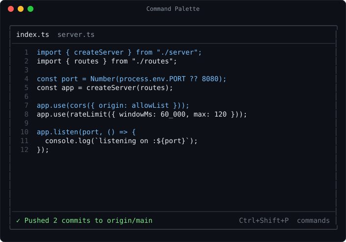</td><td width="50%"></td></tr></table>

### Terminal Session

[`terminal-session`](https://www.ascii-magic.com/ascii/terminal-session) · **built** · A shell session where commands are typed at a coloured prompt and their output streams back.

- Examples under every help screen

<table><tr><th>The piece</th><th>The kaas screen</th></tr>
<tr><td width="50%">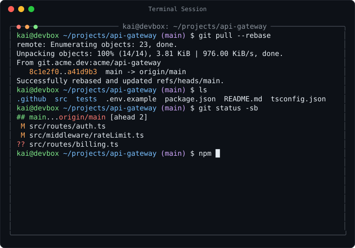</td><td width="50%">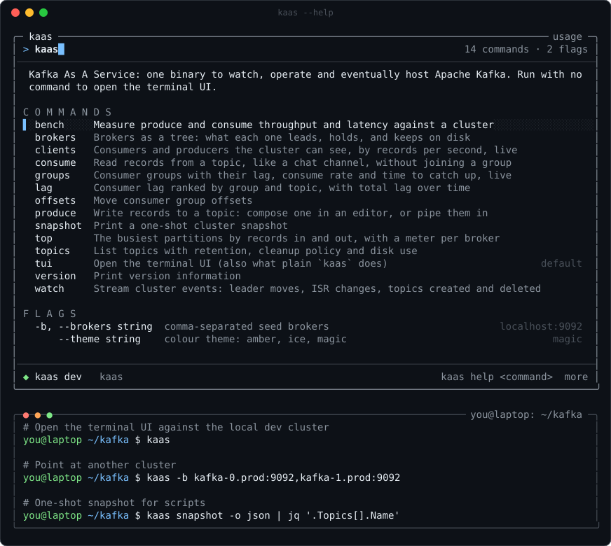</td></tr></table>

### Boot Sequence

[`boot-sequence`](https://www.ascii-magic.com/ascii/boot-sequence) · **built** · A system boot log scrolls past with green OK tags, then the machine waits at a login prompt.

- Connecting: DNS → TCP → ApiVersions → Metadata, with timings

<table><tr><th>The piece</th><th>The kaas screen</th></tr>
<tr><td width="50%">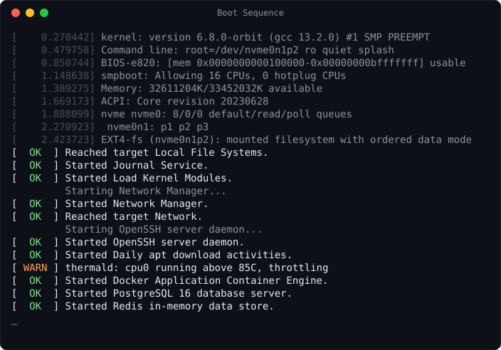</td><td width="50%"></td></tr></table>

### Server Error 500

[`page-500`](https://www.ascii-magic.com/ascii/page-500) · **built** · A 500 error page with a smoking server rack, blinking fault lights and a retry countdown.

- Cluster unreachable (503), internal error (500): per-seed probe rack

<table><tr><th>The piece</th><th>The kaas screen</th></tr>
<tr><td width="50%">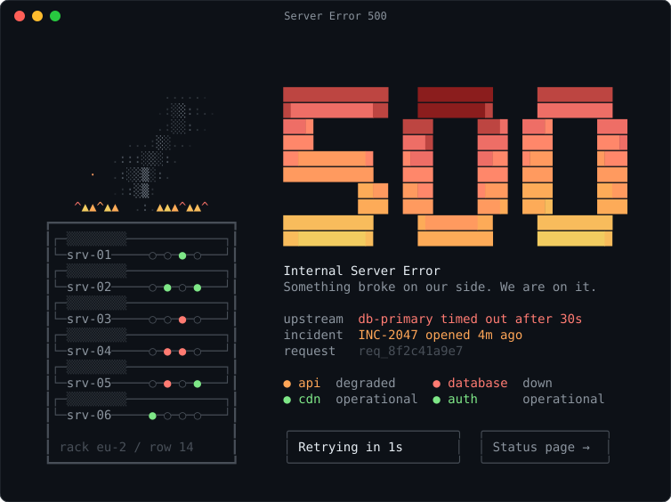</td><td width="50%"></td></tr></table>

### Lost In Space 404

[`page-404`](https://www.ascii-magic.com/ascii/page-404) · **built** · A not found page with a big glowing 404 and a lost satellite drifting through twinkling stars.

- Unknown command, topic, group or context, with "did you mean"

<table><tr><th>The piece</th><th>The kaas screen</th></tr>
<tr><td width="50%">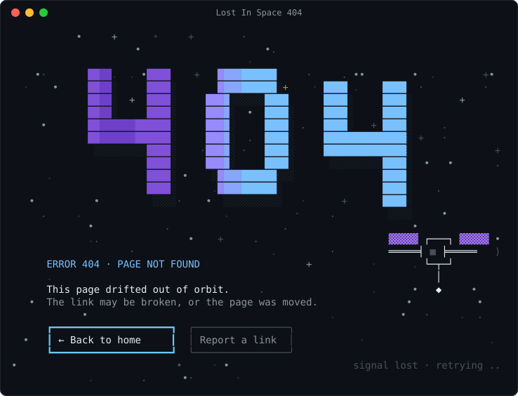</td><td width="50%"></td></tr></table>

### Form Validation Errors

[`form-validation-errors`](https://www.ascii-magic.com/ascii/form-validation-errors) · **built** · A form is submitted half filled, red errors drop in under each bad field, then each one is corrected until it submits clean.

- Bad flags and values, the bad one highlighted with the reason

<table><tr><th>The piece</th><th>The kaas screen</th></tr>
<tr><td width="50%">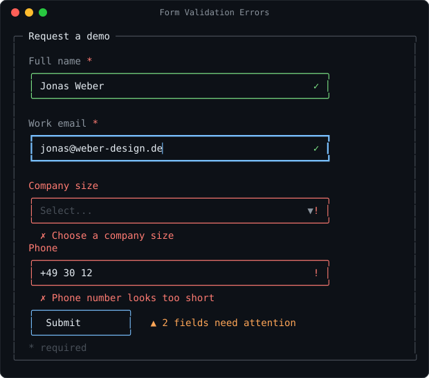</td><td width="50%"></td></tr></table>

### Modal Dialog

[`modal-dialog`](https://www.ascii-magic.com/ascii/modal-dialog) · **P1** · A delete confirmation dialog pops up over a dimmed settings page, takes a typed name and closes.

- Destructive confirm: type the name to delete a topic, group or records
- `kaas topics delete`: Type to confirm; a closing card

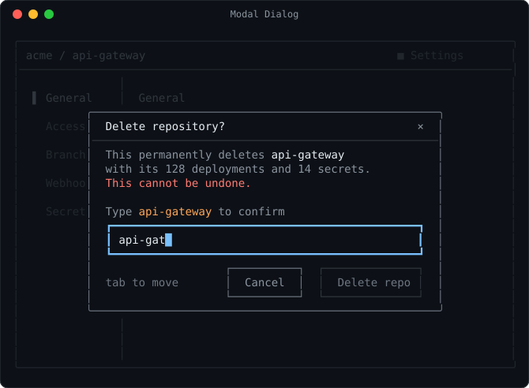

### Progress Loader

[`progress-loader`](https://www.ascii-magic.com/ascii/progress-loader) · **P1** · Four terminal progress bars filling at their own pace, with percent and a spinner.

- Multi-partition progress (delete records, offset resets)

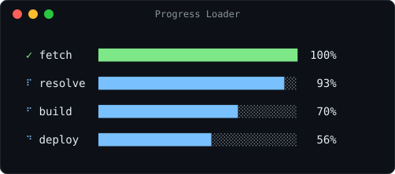

### Spinner Set

[`spinner-set`](https://www.ascii-magic.com/ascii/spinner-set) · **P1** · Twelve classic terminal spinners side by side, each labelled with its name and frame count.

- One spinner for short waits; `KAAS_REDUCED_MOTION` freezes it

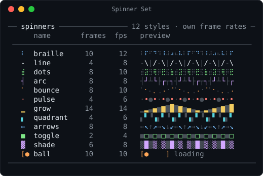

### Skeleton Loader

[`skeleton-loader`](https://www.ascii-magic.com/ascii/skeleton-loader) · **P1** · Shimmering skeleton placeholders for a feed of cards that dissolve into the real content.

- TUI screens before the first snapshot arrives

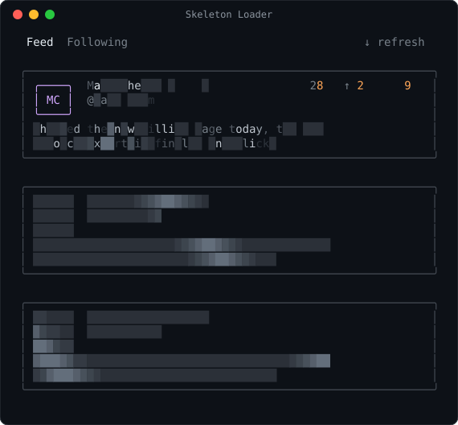

### Keyboard Keypress

[`keyboard-keypress`](https://www.ascii-magic.com/ascii/keyboard-keypress) · **P1** · A keyboard where each key sinks and lights as a sentence is typed into the text field above it, shift and space included.

- TUI `?` overlay: the keys light up as you press them

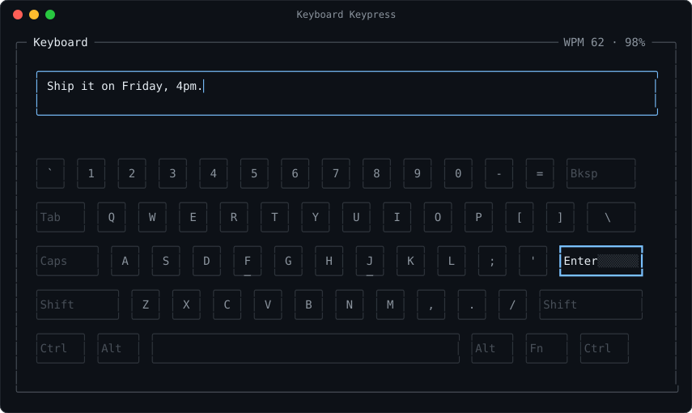

## Phase 1 commands

### Split Pane Multiplexer

[`split-pane-session`](https://www.ascii-magic.com/ascii/split-pane-session) · **built** · A terminal multiplexer split into a streaming server log, a live resource meter and a test watcher, with focus hopping between panes.

- `kaas` / `kaas tui`: Topics, events and meters in panes; panes tile as you open more

<table><tr><th>The piece</th><th>The kaas screen</th></tr>
<tr><td width="50%">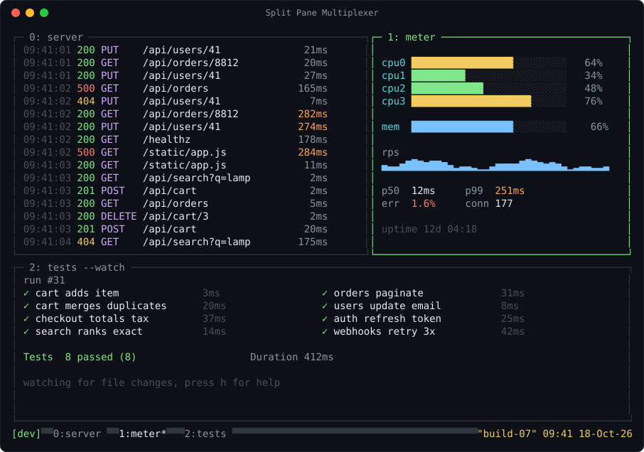</td><td width="50%"></td></tr></table>

### Window Tiling Manager

[`window-tiling-manager`](https://www.ascii-magic.com/ascii/window-tiling-manager) · **P1** · A desktop where windows open one by one and the tiling layout slides between halves, columns and a grid.

- `kaas` / `kaas tui`: Topics, events and meters in panes; panes tile as you open more

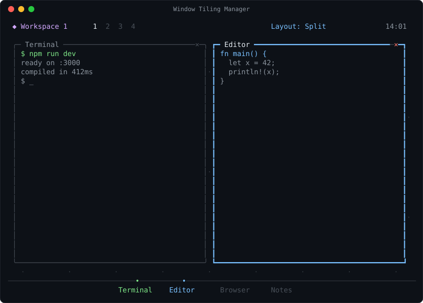

### Data Table

[`data-table`](https://www.ascii-magic.com/ascii/data-table) · **built** · A service status table that re-sorts by a new column every few seconds while a selection bar walks the rows.

- `kaas snapshot`: Topics, partitions and URPs, sortable
- `kaas topics`: Topic list with retention, cleanup and disk; prefix hierarchy as a tree

<table><tr><th>The piece</th><th>The kaas screen</th></tr>
<tr><td width="50%">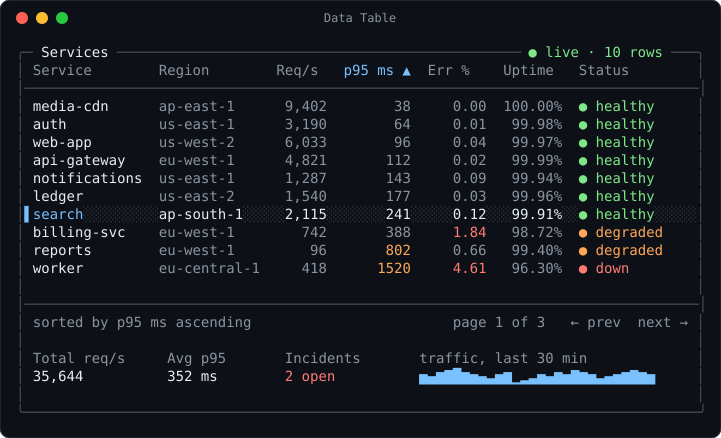</td><td width="50%"></td></tr></table>

### Toast Stack

[`toast-stack`](https://www.ascii-magic.com/ascii/toast-stack) · **built** · Notification toasts slide into the corner of an app, stack up, count down and slide away.

- `kaas watch`: Events slide in as toasts; one records/sec sparkline per `-t` topic

<table><tr><th>The piece</th><th>The kaas screen</th></tr>
<tr><td width="50%">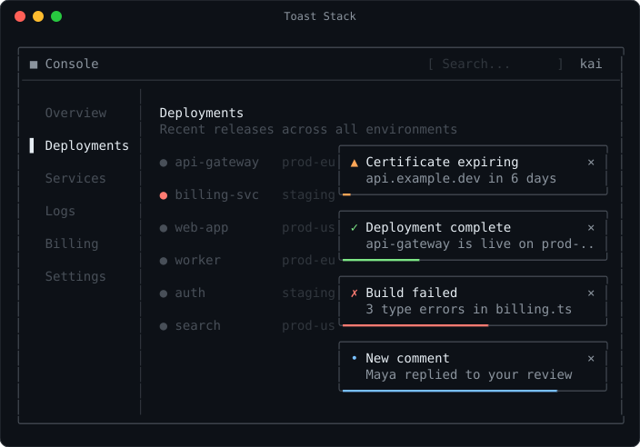</td><td width="50%"></td></tr></table>

### Benchmark Results

[`benchmark-table`](https://www.ascii-magic.com/ascii/benchmark-table) · **built** · A benchmark runner that measures each case with a live iteration counter and fills a table of timings compared to the last baseline.

- `kaas bench produce`: One row per case (size × acks × compression), a live counter, a latency histogram and a throughput graph
- `kaas bench consume`: Same, for fetch

<table><tr><th>The piece</th><th>The kaas screen</th></tr>
<tr><td width="50%">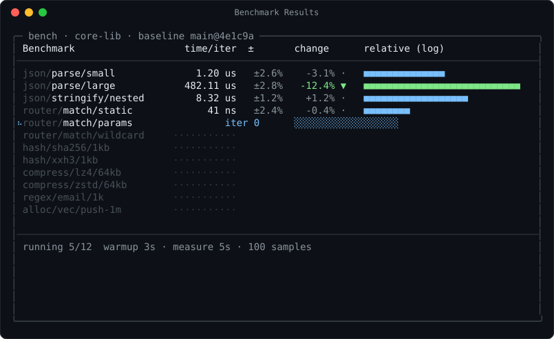</td><td width="50%"></td></tr></table>

### File Tree

[`file-tree`](https://www.ascii-magic.com/ascii/file-tree) · **built** · A project explorer where a cursor walks the tree, opening and closing folders as it goes.

- `kaas topics`: Topic list with retention, cleanup and disk; prefix hierarchy as a tree

<table><tr><th>The piece</th><th>The kaas screen</th></tr>
<tr><td width="50%">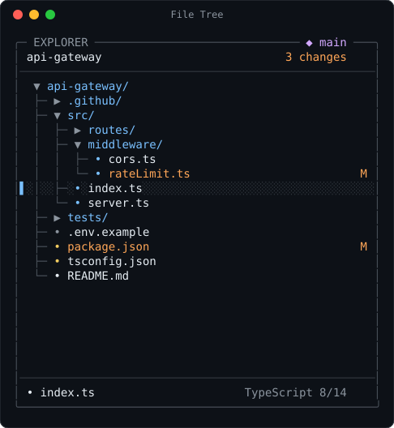</td><td width="50%"></td></tr></table>

### Partition Editor

[`disk-partitioner`](https://www.ascii-magic.com/ascii/disk-partitioner) · **built** · A curses-style partition editor that carves a new partition out of free space, writes the table and formats it.

- `kaas topics describe`: Partitions laid out per broker, leaders and replicas
- `kaas topics alter --partitions`: New partitions carved from the free space, then written

<table><tr><th>The piece</th><th>The kaas screen</th></tr>
<tr><td width="50%">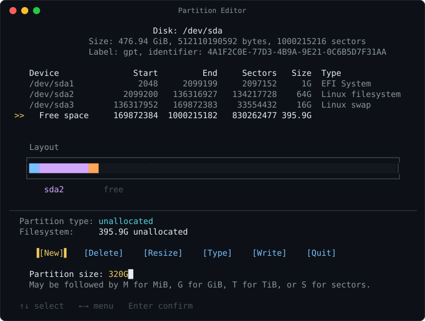</td><td width="50%"></td></tr></table>

### Onboarding Stepper

[`onboarding-stepper`](https://www.ascii-magic.com/ascii/onboarding-stepper) · **P1** · A setup wizard walks through four steps, filling fields, picking options and ticking the stepper rail as it goes.

- `kaas topics create`: Name → partitions → replication → configs → create
- `kaas offsets reset`: Group → topic → strategy → preview of offset changes → apply

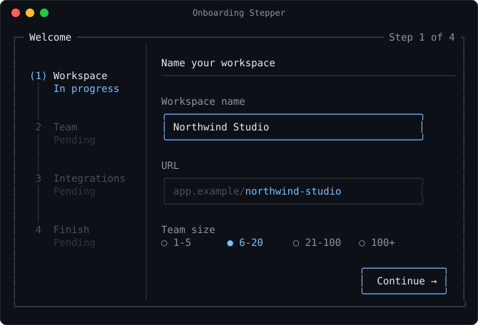

### Process Tree Live

[`process-tree`](https://www.ascii-magic.com/ascii/process-tree) · **built** · A live process tree with branch lines where build workers and request handlers spawn in green, run and exit in red.

- `kaas brokers`: Broker → leaders → partitions tree; disk, network and request gauges

<table><tr><th>The piece</th><th>The kaas screen</th></tr>
<tr><td width="50%">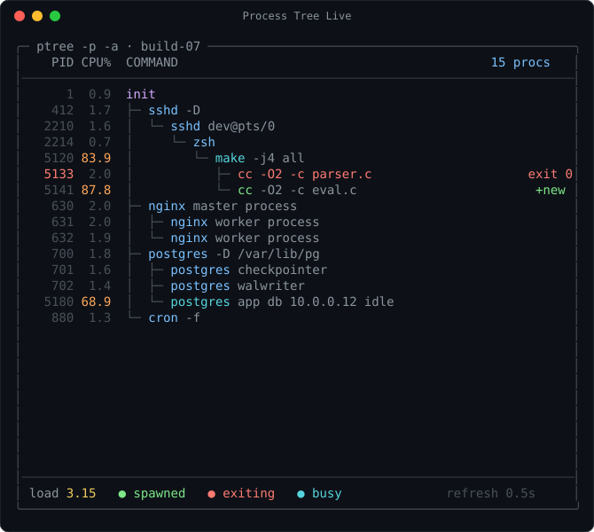</td><td width="50%"></td></tr></table>

### Process Task Manager

[`process-task-manager`](https://www.ascii-magic.com/ascii/process-task-manager) · **built** · A task manager where per process CPU and memory numbers churn, rows slide to re-sort by load, and a runaway process gets ended.

- `kaas groups`: Groups and members with lag and rate, re-sorting live
- `kaas clients`: Connected clients by request rate

<table><tr><th>The piece</th><th>The kaas screen</th></tr>
<tr><td width="50%">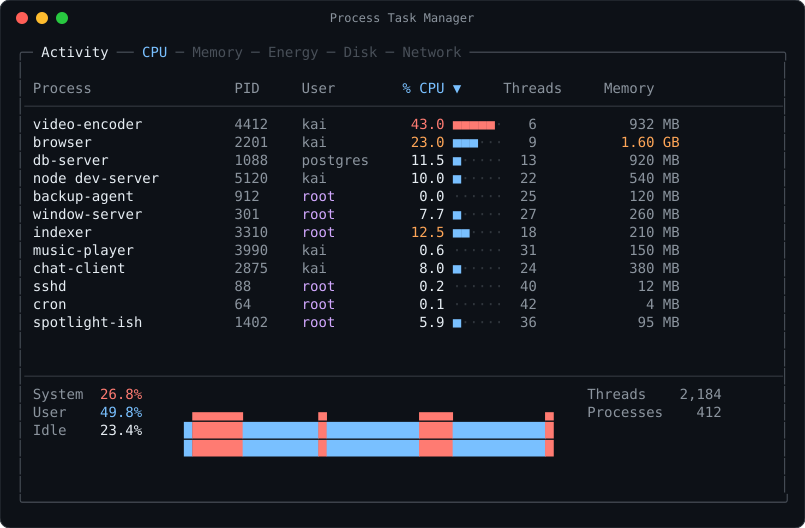</td><td width="50%"></td></tr></table>

### Process Viewer Sort

[`process-sorter`](https://www.ascii-magic.com/ascii/process-sorter) · **P1** · An interactive process viewer with meter bars where the table slides into a new order as the sort column changes.

- `kaas top`: Partitions by bytes in/out, with meter bars

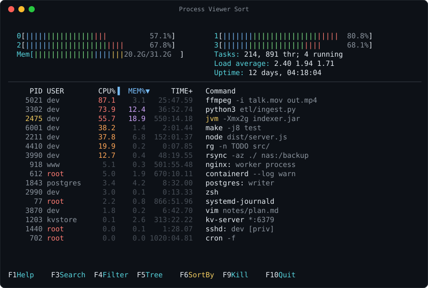

### Relay Chat Channel

[`relay-chat-channel`](https://www.ascii-magic.com/ascii/relay-chat-channel) · **P1** · A terminal relay chat client where people join and leave a channel, chat with timestamps and the nick list updates beside them.

- `kaas consume` / `tail`: Records stream in like a channel: time, partition, key, value

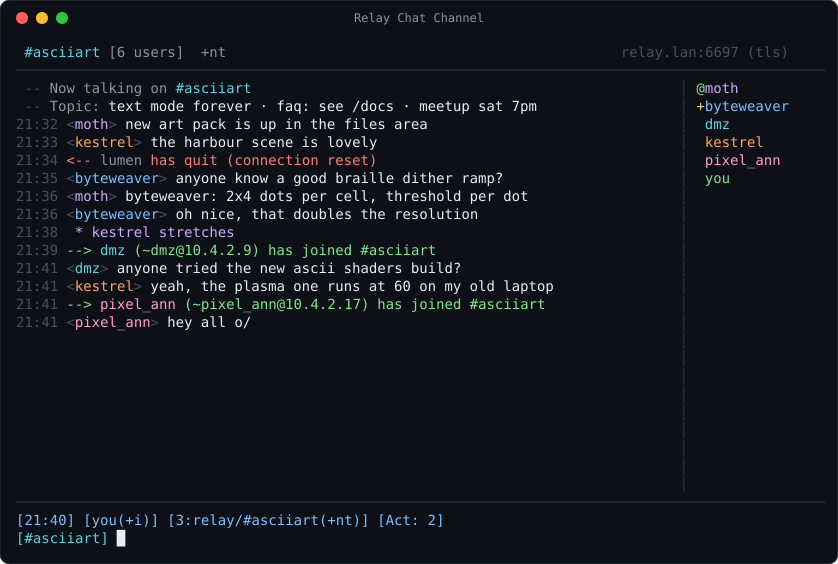

### Code Editor

[`code-editor`](https://www.ascii-magic.com/ascii/code-editor) · **P1** · An editor window with line numbers where a small rate limiter is typed out in syntax colours.

- `kaas produce`: Compose key, value and headers with JSON highlighting

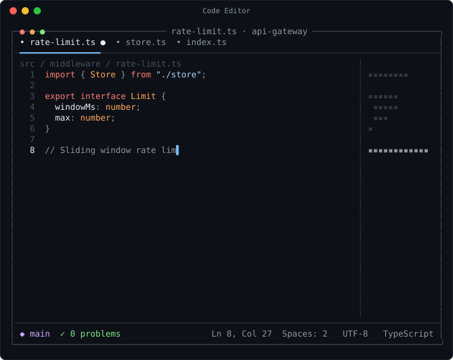

### Upload Dropzone

[`upload-dropzone`](https://www.ascii-magic.com/ascii/upload-dropzone) · **P1** · A cursor drags a stack of files onto a drop zone that lights up, then each file uploads with its own progress bar.

- `kaas produce --file`: File records upload with per-file progress

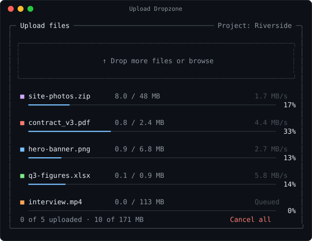

### Infra Plan and Apply

[`infra-plan-diff`](https://www.ascii-magic.com/ascii/infra-plan-diff) · **P1** · An infrastructure-as-code plan that lists resources to add, change and destroy in coloured diffs, then applies them with elapsed timers.

- `kaas offsets reset`: Group → topic → strategy → preview of offset changes → apply
- `kaas plan`: Topics, ACLs and quotas to add, change or destroy

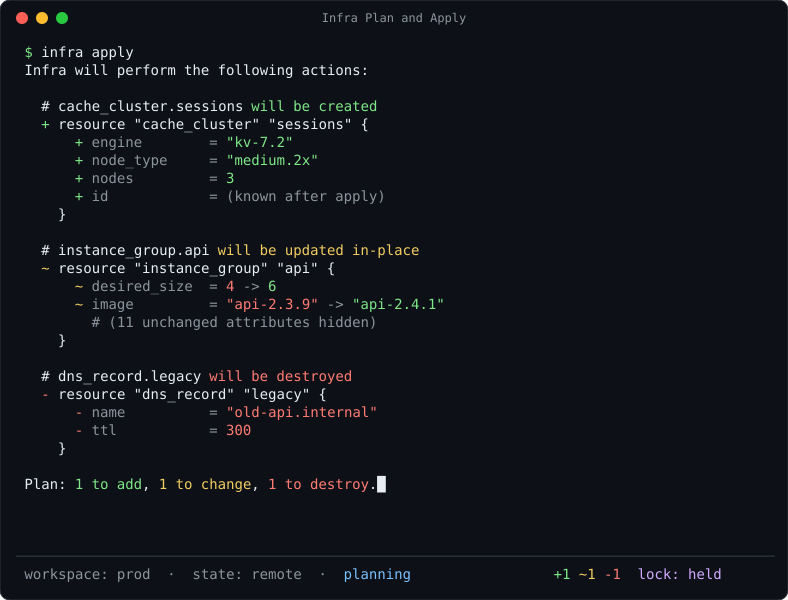

### Bisect Hunt

[`bisect-hunt`](https://www.ascii-magic.com/ascii/bisect-hunt) · **P1** · A bisect session that tests the middle commit, marks it good or bad and halves the range until the first bad commit is found.

- `kaas offsets find --time`: Binary search for the offset at a time or the first bad record

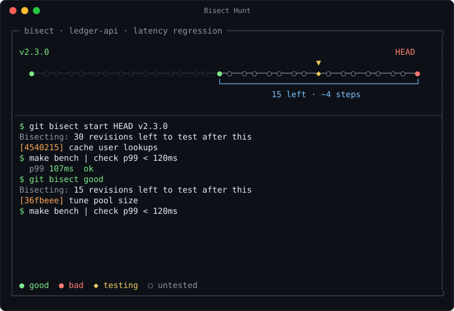

### Date Range Picker

[`date-range-picker`](https://www.ascii-magic.com/ascii/date-range-picker) · **P1** · A two month calendar where a start date is clicked, the range stretches with the cursor and the night count updates.

- `kaas consume --from --to`: Pick a time window to read

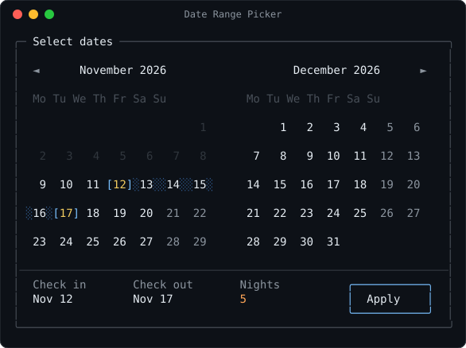

### Packet Capture

[`packet-sniffer`](https://www.ascii-magic.com/ascii/packet-sniffer) · **P1** · A packet capture tool streaming colour-coded TCP, UDP, DNS and TLS packets with protocol counters and a hex dump of the selected packet.

- `kaas sniff`: Kafka protocol requests, colour-coded by API key

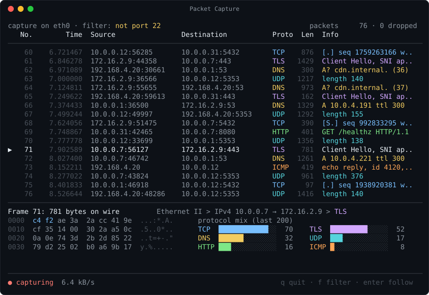

### Request Waterfall

[`network-waterfall`](https://www.ascii-magic.com/ascii/network-waterfall) · **P1** · A browser network panel where requests appear as a page loads, each with queue, connect, wait and download segments on a waterfall.

- `kaas sniff --trace`: One request: queue, connect, send, wait, ack

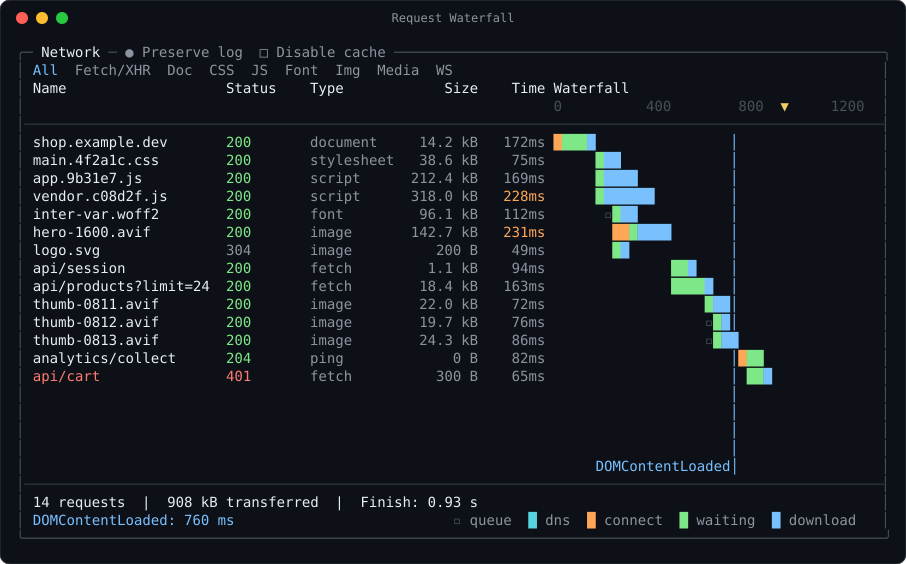

### Profiler Flame Graph

[`flame-graph`](https://www.ascii-magic.com/ascii/flame-graph) · **P1** · A CPU profiler flame graph whose stacks grow and settle as samples come in while a cursor inspects the hottest frames.

- `kaas sniff --profile`: Where produce and fetch latency goes, by stage

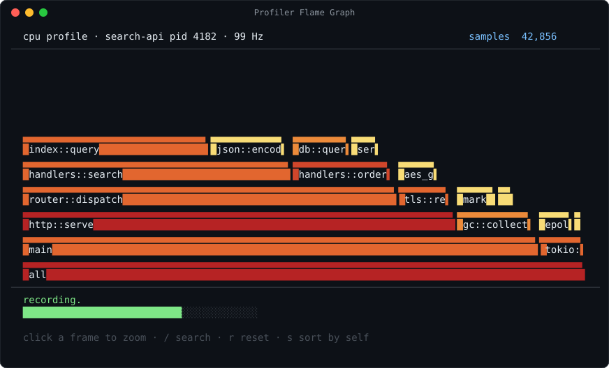

### Heap Allocator Map

[`heap-map`](https://www.ascii-magic.com/ascii/heap-map) · **P1** · A memory allocator page map where blocks are allocated and freed, fragmentation builds up and a compaction pass packs it tight.

- `kaas segments`: A partition's log segments: size, compaction, holes

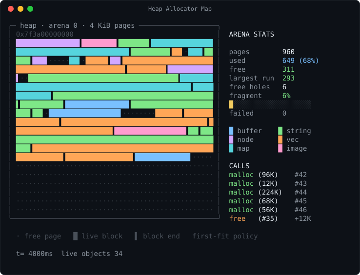

### Settings Toggles

[`settings-toggles`](https://www.ascii-magic.com/ascii/settings-toggles) · **P1** · A settings panel where a focus marker moves down the list, flipping switches and dragging sliders.

- `kaas config`: Topic and broker configs, with non-defaults flagged

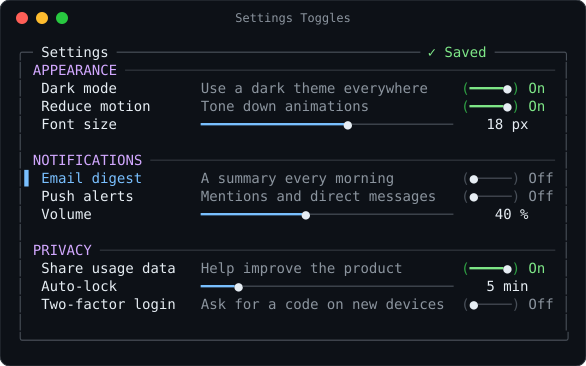

### Modal Editor Session

[`modal-editor`](https://www.ascii-magic.com/ascii/modal-editor) · **P1** · A modal terminal text editor where the cursor hops, a line is deleted, a new one inserted, a search and replace runs and the file is saved.

- `kaas config edit`: Edit configs in a vi-style buffer; diff before apply

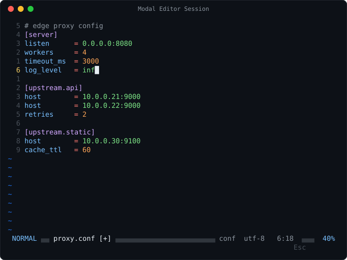

### Test Suite Dots

[`test-runner-dots`](https://www.ascii-magic.com/ascii/test-runner-dots) · **P1** · A test runner that prints a dot per passing test across files, flags a failure with a diff and ends in a coloured summary.

- `kaas doctor`: A dot per check; per-topic health bars by threshold

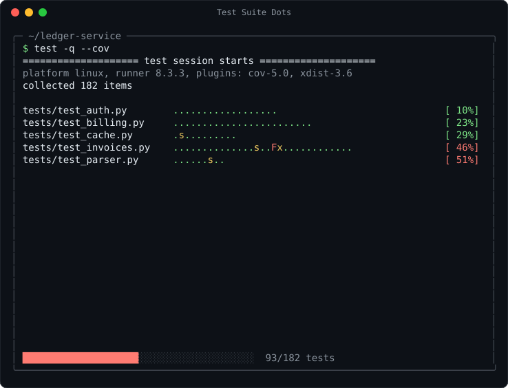

### Coverage Report

[`coverage-report`](https://www.ascii-magic.com/ascii/coverage-report) · **P1** · A code coverage report where per-file bars fill up, colour by threshold and then re-sort so the weakest files rise to the top.

- `kaas doctor`: A dot per check; per-topic health bars by threshold

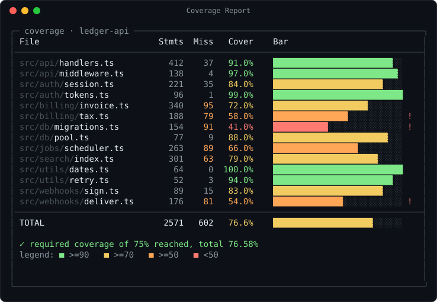

### DNS Resolver Chain

[`dns-resolver-chain`](https://www.ascii-magic.com/ascii/dns-resolver-chain) · **P1** · A DNS lookup diagram where a query packet hops from the client to the resolver, root, TLD and authoritative servers and the answer returns.

- `kaas doctor network`: Seed → metadata → advertised listener → leader, hop by hop

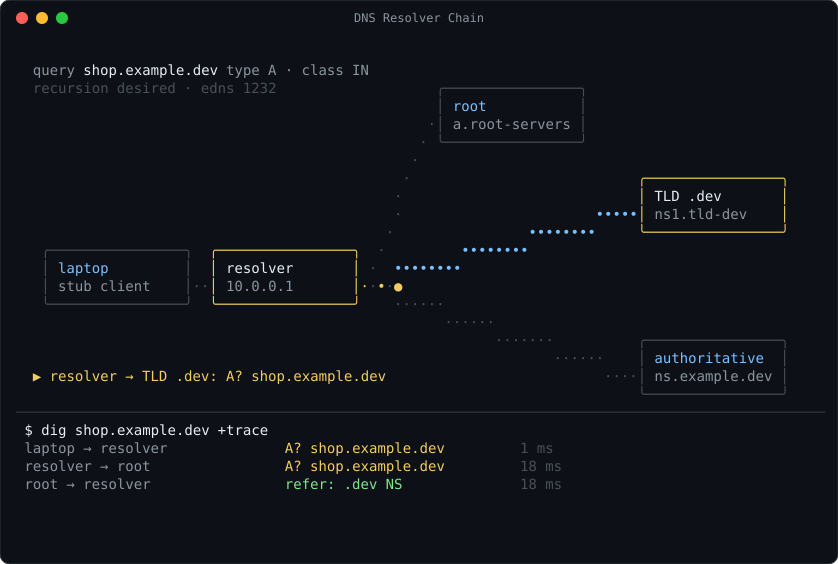

### Dial-Up Handshake

[`dialup-handshake`](https://www.ascii-magic.com/ascii/dialup-handshake) · **P1** · A retro terminal program that dials out, shows the modem handshake as a noisy signal with front panel lights, connects and lands on a bulletin board.

- `kaas doctor auth`: TLS and SASL handshake, step by step

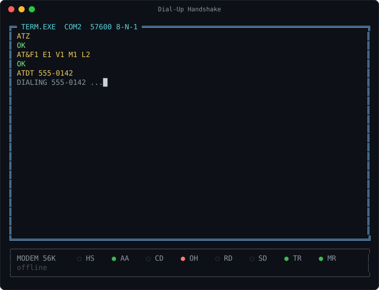

### Spreadsheet Recalc

[`spreadsheet-recalc`](https://www.ascii-magic.com/ascii/spreadsheet-recalc) · **P1** · A budget spreadsheet where a cell is edited, its formula bar updates and the dependent totals flash as they recalculate.

- `kaas capacity`: Edit throughput or retention; disk and broker counts recalculate

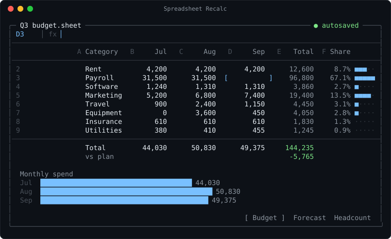

### SQL Query Runner

[`sql-query-runner`](https://www.ascii-magic.com/ascii/sql-query-runner) · **P1** · A database console types a SQL query with highlighting, runs it and fills a result grid with rows and timing.

- `kaas query`: CEL filter over a topic; results fill a grid

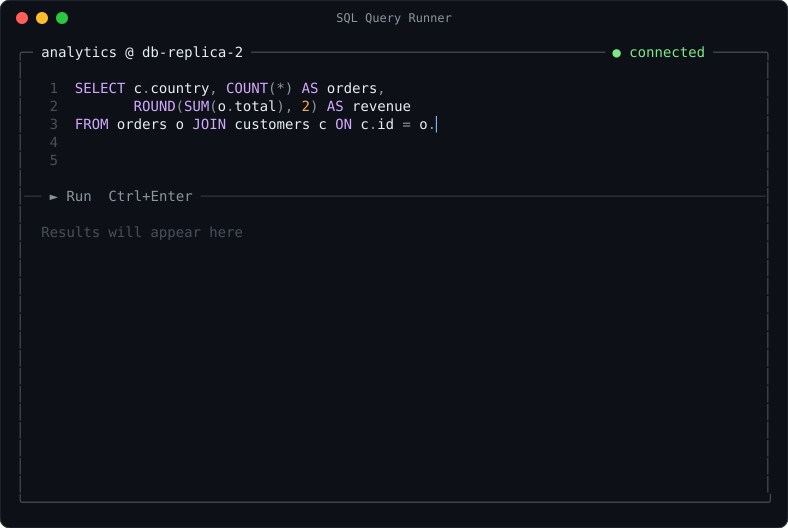

### Debugger Stepping

[`ide-debugger-stepping`](https://www.ascii-magic.com/ascii/ide-debugger-stepping) · **P1** · An editor debugger steps line by line through a loop, pausing on breakpoints while locals, watches and the call stack change.

- `kaas filter test`: Step a CEL expression over sample records, with locals

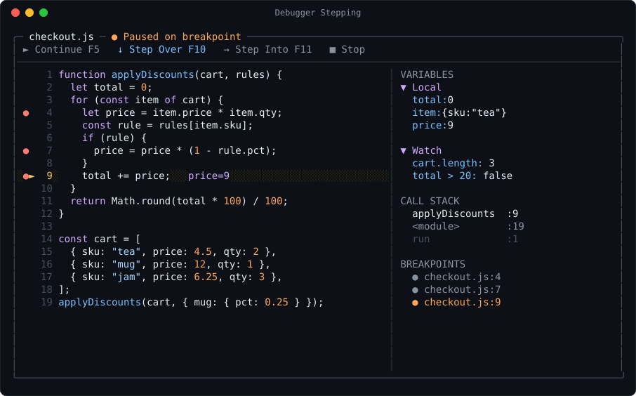

### Search Autocomplete

[`search-autocomplete`](https://www.ascii-magic.com/ascii/search-autocomplete) · **P1** · A search box where suggestions narrow and highlight with every keystroke, then a result is picked with the arrow keys.

- `kaas search`: Find topics, groups and contexts as you type

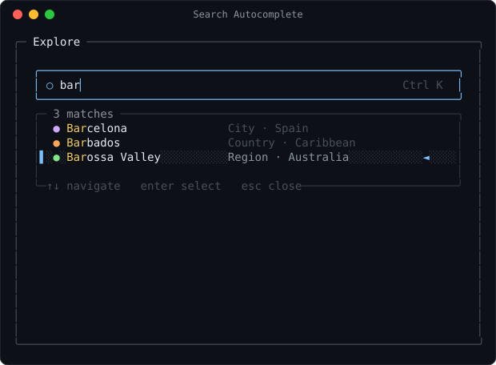

### Tab Bar

[`tab-bar`](https://www.ascii-magic.com/ascii/tab-bar) · **P1** · An editor tab bar where the active underline slides between files and the content swaps beneath.

- `kaas ctx`: Contexts as tabs; switch clusters

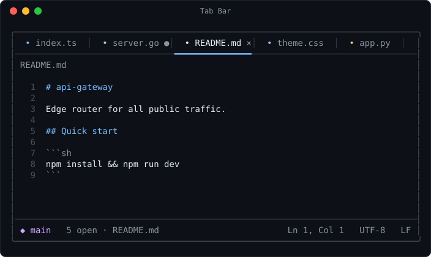

### Secure Shell Login

[`ssh-login`](https://www.ascii-magic.com/ascii/ssh-login) · **P1** · A remote shell session that accepts a host key, prints a welcome banner with system stats, runs two commands and logs out.

- `kaas ctx use`: Connect banner: cluster ID, version, brokers, topics
- `kaas exec <broker>`: Shell into a broker pod

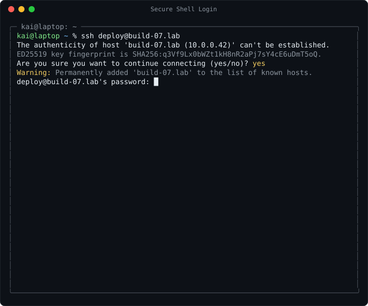

### Firmware Setup Utility

[`bios-setup`](https://www.ascii-magic.com/ascii/bios-setup) · **P1** · A retro firmware setup screen where a cursor walks the tabs, enables a setting, reorders boot devices and saves.

- `kaas init`: First-run setup: contexts, auth, theme

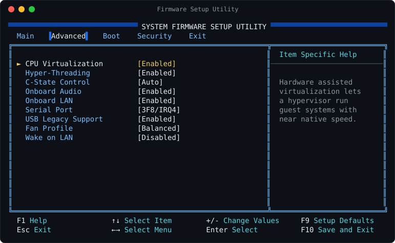

### Color Picker Sliders

[`color-picker-sliders`](https://www.ascii-magic.com/ascii/color-picker-sliders) · **P1** · A colour picker where the hue strip, the shade field and the RGB sliders move together and the swatch and hex code follow.

- `kaas theme`: Edit or preview a theme's roles

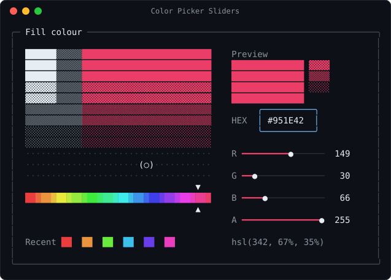

### README Badge Row

[`readme-badges`](https://www.ascii-magic.com/ascii/readme-badges) · **P1** · A README's badge row where build turns passing, coverage climbs, downloads tick up and the star count rolls over.

- `kaas version`: Version, commit, Go version and build date as badges

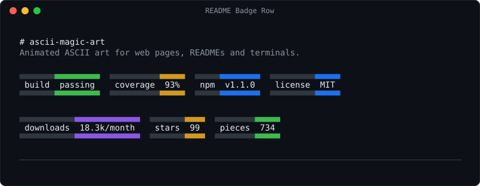

### Release Published

[`release-published`](https://www.ascii-magic.com/ascii/release-published) · **P1** · A terminal tags v1.1.0, pushes it, and the release notes type themselves out with new features, fixes and thanks to contributors.

- `kaas self-update`: New version and its release notes

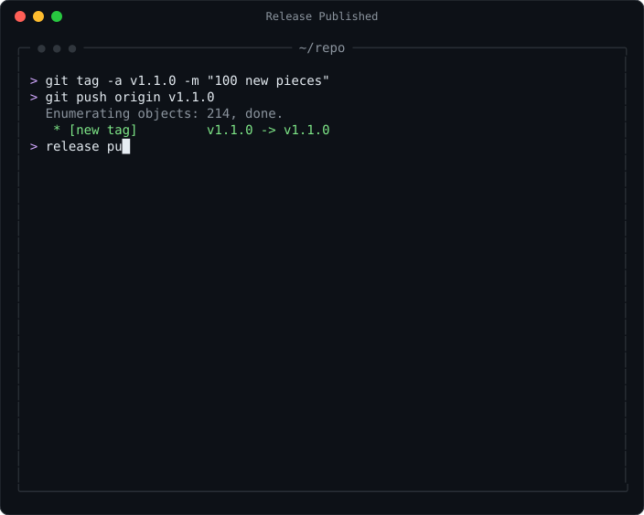

### Compiler Warnings

[`compiler-output`](https://www.ascii-magic.com/ascii/compiler-output) · **P1** · A compiler build log that compiles dependencies, prints an unused variable warning with a pointed snippet and finishes green.

- `kaas lint`: Policy and config warnings, pointing at the offending line

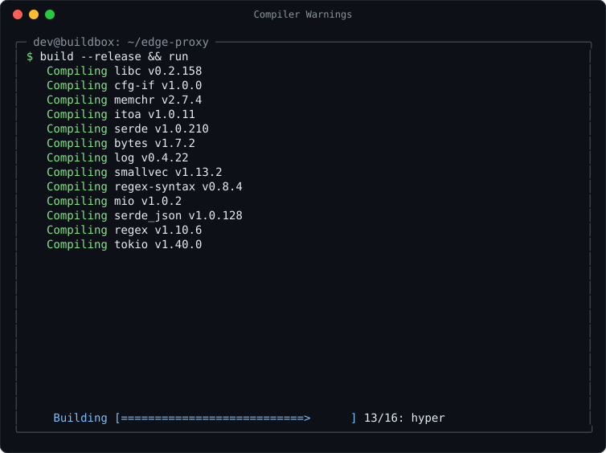

### Delivery Route Tracker

[`delivery-route-tracker`](https://www.ascii-magic.com/ascii/delivery-route-tracker) · **P1** · A delivery tracking screen where the route draws across a street grid, the courier moves along it and the order steps tick to delivered.

- `kaas trace <key>`: Follow a key across topics, hop by hop

### Inbox List

[`inbox-list`](https://www.ascii-magic.com/ascii/inbox-list) · **P1** · An email inbox with unread dots, stars and previews, where new mail slides in at the top.

- `kaas dlq`: Dead-letter records like mail; an empty card when clean

## Phase 2: management plane

### Merge Conflict Resolver

[`merge-conflict-resolver`](https://www.ascii-magic.com/ascii/merge-conflict-resolver) · **P2** · A three pane merge editor walks through conflicting hunks, accepting ours, theirs or both until the file is clean.

- `kaas plan` (drift): Desired vs live, hunk by hunk: keep ours, take theirs

### Interactive Rebase Todo

[`rebase-todo`](https://www.ascii-magic.com/ascii/rebase-todo) · **P2** · An interactive rebase todo list where commits are squashed, reworded, dropped and reordered before the rebase replays them.

- `kaas plan edit`: Reorder, skip or squash plan steps

### Rolling Deployment

[`cluster-rollout`](https://www.ascii-magic.com/ascii/cluster-rollout) · **P2** · A cluster rolling update where new pods start, pass readiness and replace old ones while a status line counts up to a successful rollout.

- `kaas apply`: Countdown to abort; changes roll out; done card
- `kaas cluster roll`: Broker-by-broker restart with ISR gating; a "be right back" page for clients

### Pull Request Merged

[`pr-merged`](https://www.ascii-magic.com/ascii/pr-merged) · **P2** · A pull request page where the checks turn green one by one, a review approves it and the merge button lands it, branch deleted.

- `kaas change`: A change request: checks, approvals, merged

### Git Log Graph

[`git-log-graph`](https://www.ascii-magic.com/ascii/git-log-graph) · **P2** · A git log graph with feature branches merging back into main as new commits land on top.

- `kaas schema`: Subject versions and compatibility as a graph
- `kaas history`: Config and ACL changes over time

### Package Publish

[`package-publish`](https://www.ascii-magic.com/ascii/package-publish) · **P2** · A terminal packs a package, lists its files, publishes it to the registry, and the weekly downloads graph beside it starts to climb.

- `kaas schema register`: Pack, check compatibility, publish to the registry

### Twin Pane Commander

[`twin-pane-commander`](https://www.ascii-magic.com/ascii/twin-pane-commander) · **P2** · A retro two-pane file manager where the cursor picks files, a copy dialog fills its progress bar and the files land in the other pane.

- `kaas acl`: Principals on the left, resources on the right; grants copied across
- `kaas mirror`: Copy topics between clusters, with progress

### Password Strength Meter

[`password-strength-meter`](https://www.ascii-magic.com/ascii/password-strength-meter) · **P2** · A password field where each keystroke moves a strength meter from weak to strong and ticks off the rules.

- `kaas user create`: SCRAM credential with a strength meter

### Login Form

[`login-form`](https://www.ascii-magic.com/ascii/login-form) · **P2** · A sign-in card where the email and password fill in, the button presses and a success tick draws itself.

- `kaas login`: Sign in, then MFA or a device code

### OTP Code Entry

[`otp-code-entry`](https://www.ascii-magic.com/ascii/otp-code-entry) · **P2** · A two step verification screen where a six digit code is typed, shakes as wrong, is retyped and goes green.

- `kaas login`: Sign in, then MFA or a device code

### Download Queue

[`download-queue`](https://www.ascii-magic.com/ascii/download-queue) · **P2** · A download manager where six files report size, speed and time left, then finish one by one.

- `kaas reassign`: Each partition move with size, speed and ETA

### Kanban Board

[`kanban-board`](https://www.ascii-magic.com/ascii/kanban-board) · **P2** · A three column task board where cards lift, travel across and settle into place.

- `kaas rebalance`: Partitions move between broker columns

### API Request Inspector

[`api-request-inspector`](https://www.ascii-magic.com/ascii/api-request-inspector) · **P2** · A request inspector where API calls stream in with method, path, status and timing bars, and one is opened to show its headers.

- `kaas gateway log`: Gateway requests with method, status and timing bars

### Smart Home Panel

[`smart-home-panel`](https://www.ascii-magic.com/ascii/smart-home-panel) · **P2** · A home dashboard where lights flip on room by room, the thermostat climbs to its target, the door locks and the energy graph scrolls.

- `kaas fleet`: Every cluster's status at a glance; traffic by region

### Weather City Widget

[`weather-city-widget`](https://www.ascii-magic.com/ascii/weather-city-widget) · **P2** · A weather widget that slides from city to city, each with an animated sky icon, hourly temperatures and a five day outlook.

- `kaas fleet --carousel`: Slides cluster to cluster with its health "forecast"

## Phase 3: managed Kafka

### Install Log

[`install-log`](https://www.ascii-magic.com/ascii/install-log) · **P3** · A package manager install log resolving, fetching and linking packages, ending in a green summary.

- `kaas install`: Operator install: resolve, fetch, apply

### Container Layer Pull

[`image-layer-pull`](https://www.ascii-magic.com/ascii/image-layer-pull) · **P3** · A container image pull where each layer downloads with its own progress bar, extracts and completes, ending with a digest.

- `kaas cluster create`: Images pull layer by layer; provisioning card

### Maintenance Mode

[`maintenance-mode`](https://www.ascii-magic.com/ascii/maintenance-mode) · **P3** · A be right back page with a turning gear, a rocking wrench and a live list of upgrade steps.

- `kaas cluster roll`: Broker-by-broker restart with ISR gating; a "be right back" page for clients

### Pod Autoscaler

[`pod-autoscaler`](https://www.ascii-magic.com/ascii/pod-autoscaler) · **P3** · A container cluster view where a traffic spike pushes CPU up, new pods spin up across the nodes, then scale back down as load eases.

- `kaas cluster autoscale`: Load pushes CPU up; brokers are added

### Calendar Month

[`calendar-month`](https://www.ascii-magic.com/ascii/calendar-month) · **P3** · A month calendar with coloured event dots, today marked, and a selection hopping between days with an agenda panel.

- `kaas cluster maintenance`: Maintenance windows on a calendar

### Power-On Memory Count

[`post-memory-test`](https://www.ascii-magic.com/ascii/post-memory-test) · **P3** · A retro power-on self test that counts up memory, detects drives one by one and hands off to the boot loader.

- `kaas agent`: Agent self-test: disks, memory, cluster handoff

### Pricing Plan Toggle

[`pricing-toggle-table`](https://www.ascii-magic.com/ascii/pricing-toggle-table) · **P3** · A three plan pricing table where the billing switch flips between monthly and yearly, prices roll to the new numbers and a plan is picked.

- `kaas plans`: Managed tiers, monthly vs yearly

### Checkout Payment Flow

[`checkout-payment-flow`](https://www.ascii-magic.com/ascii/checkout-payment-flow) · **P3** · A checkout page fills shipping and card details, processes the payment and lands on a confirmed order.

- `kaas billing`: Upgrade a plan

### Calculator Keypad

[`calculator-app`](https://www.ascii-magic.com/ascii/calculator-app) · **P3** · A calculator where keys light up as they are pressed, the display builds an expression and the result rolls in on equals.

- `kaas calc`: Quick partition and throughput arithmetic

## Unused, on purpose

### Chat Thread

[`chat-thread`](https://www.ascii-magic.com/ascii/chat-thread) · **unused** · A chat conversation where bubbles appear after a typing indicator and replies are typed in the composer.

- A chat UI; `consume` already uses relay-chat-channel

### Spectrum Music Player

[`spectrum-music-player`](https://www.ascii-magic.com/ascii/spectrum-music-player) · **unused** · A music player window with bouncing spectrum bars, a moving progress bar and a playlist that advances track by track.

- Music

### Star Rating Review

[`star-rating-review`](https://www.ascii-magic.com/ascii/star-rating-review) · **unused** · A review card where the cursor hovers across five stars, settles on a rating, writes a short review and posts it to the tally.

- Product reviews

### Star Button Click

[`repo-star-button`](https://www.ascii-magic.com/ascii/repo-star-button) · **unused** · A repository header with Watch, Fork and Star buttons: the cursor glides over, clicks Star, and the count ticks over to your number.

- Repository stars

---

*Piece stills © ascii-magic-art contributors, MIT ([licence](img/ui/LICENSE.ascii-magic-art)).*
